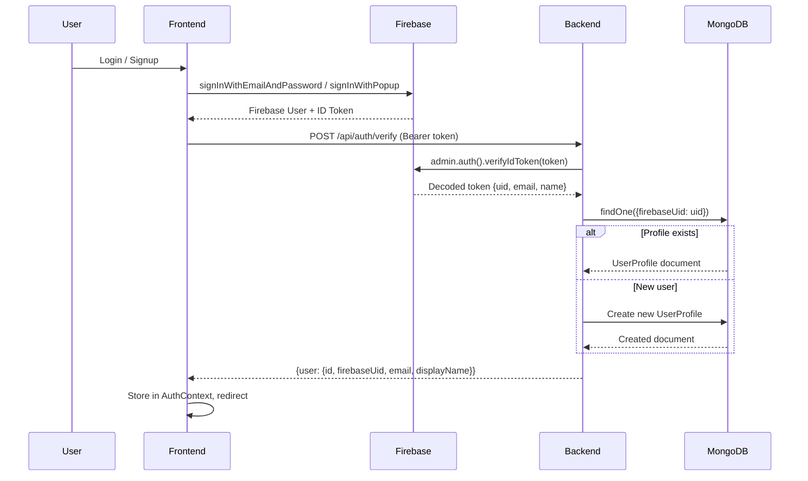
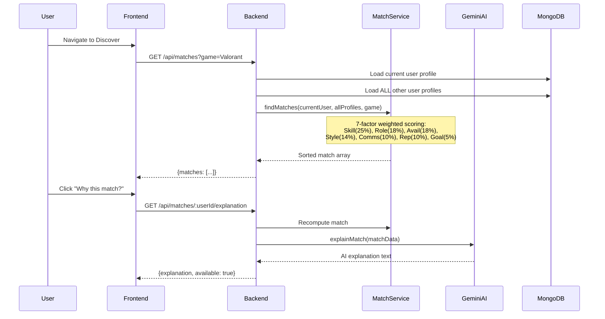
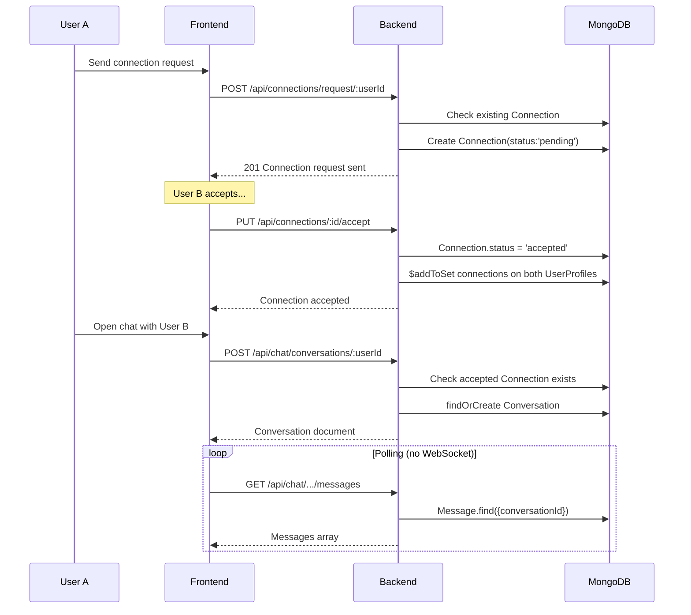
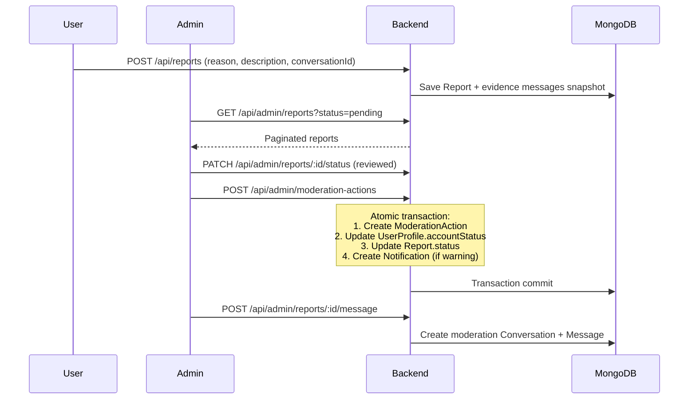

# ZYNC — Architecture Analysis & Implementation Roadmap

> **Prepared:** 2026-10-21 · **Scope:** Full-stack audit of the existing ZYNC repository  
> **Status:** Read-only analysis — no code has been modified

---

## 1. Executive Summary

**ZYNC** is a gaming teammate-matching platform (BGMI, Valorant, Brawl Stars) built as a React + Express monorepo. It features AI-powered matching via Gemini, Firebase Authentication, MongoDB data layer, real-time chat, a reputation/rating system, content moderation with admin tooling, and a support ticket system.

The backend is **functionally complete and well-tested** (14 test files, covering moderation flows, chat contexts, ratings, matching, and support tickets). The frontend is **structurally complete** with 12 pages, 5 admin pages, role-gated routing, and a unified API service layer — but has **no real-time capabilities** (polling-only chat), **significant UX gaps** in the admin panel, and several **architectural inconsistencies** that will compound as the codebase scales.

### Overall Health Assessment

| Layer | Status | Confidence |
|-------|--------|------------|
| Database models | ✅ Solid | Verified via code inspection |
| Backend API routes/controllers | ✅ Functional, well-structured | Verified via tests + code |
| Authentication & authorization | ✅ Working (Firebase + middleware chain) | Verified |
| Matching engine | ✅ Deterministic, well-tested | Verified via tests |
| Gemini AI integration | ⚠️ Functional but fragile | Code inspection only |
| Frontend routing & page structure | ✅ Complete | Code inspection |
| Frontend ↔ Backend API wiring | ⚠️ Mostly working, env var mismatch | Verified (see §4) |
| Real-time / WebSocket | ❌ Missing entirely | Verified |
| Error handling & validation | ⚠️ Inconsistent across layers | Code inspection |
| Security hardening | ⚠️ Several gaps | Code inspection |
| Test coverage | ⚠️ Backend only; no frontend tests | Verified |

---

## 2. Current Architecture Diagram

```mermaid
graph TB
    subgraph "Frontend — React 19 + Vite 8"
        FE_Main["main.jsx"]
        FE_Auth["AuthContext"]
        FE_Router["React Router v7"]
        FE_API["services/api.js<br/>(fetchWithAuth)"]
        FE_Firebase["Firebase Client SDK"]
        
        subgraph "Pages (12)"
            Landing
            Login
            Onboarding
            Dashboard
            Discover
            Connections
            PlayerProfile
            Inbox
            Chat
            Notifications
            Support
            AccountSuspended
        end

        subgraph "Admin Pages (5)"
            AdminOverview
            AdminUsers
            AdminReports
            AdminTickets
            AdminNotifications
        end

        subgraph "Components (5)"
            Navbar
            ProtectedRoute
            AdminRoute
            RateModal
            ReportModal
        end

        subgraph "Layouts (1)"
            AdminLayout
        end
    end

    subgraph "Backend — Express 5 + Node.js"
        BE_Server["server.js"]
        
        subgraph "Middleware (3)"
            MW_Auth["authMiddleware<br/>(verifyToken)"]
            MW_Admin["adminMiddleware<br/>(verifySuperAdmin)"]
            MW_Active["activeMiddleware<br/>(enforceActiveUser)"]
        end

        subgraph "Route Modules (11)"
            R_Auth["authRoutes"]
            R_Profile["profileRoutes"]
            R_Match["matchRoutes"]
            R_Conn["connectionRoutes"]
            R_Presence["presenceRoutes"]
            R_Chat["chatRoutes"]
            R_Report["reportRoutes"]
            R_Rating["ratingRoutes"]
            R_Support["supportRoutes"]
            R_Notif["notificationRoutes"]
            R_Admin["adminRoutes"]
        end

        subgraph "Controllers (12)"
            C_Auth["authController"]
            C_Profile["profileController"]
            C_Match["matchController"]
            C_Conn["connectionController"]
            C_Chat["chatController"]
            C_Presence["presenceController"]
            C_Report["reportController"]
            C_Rating["ratingController"]
            C_Support["supportController"]
            C_Notif["notificationController"]
            C_Admin["adminController"]
            C_AdminNotif["adminNotifController"]
        end

        subgraph "Services (2)"
            S_Match["matchingService<br/>(Deterministic)"]
            S_Gemini["geminiService<br/>(Gemini AI)"]
        end
    end

    subgraph "Data Layer"
        MongoDB[(MongoDB Atlas)]
        Firebase_Auth[("Firebase Auth")]
        Gemini_API["Gemini API<br/>(gemini-2.5-flash-lite)"]
    end

    subgraph "Mongoose Models (11)"
        M_User["UserProfile"]
        M_Conn["Connection"]
        M_Conv["Conversation"]
        M_Msg["Message"]
        M_Team["Team"]
        M_Rating["Rating"]
        M_Report["Report"]
        M_Support["SupportTicket"]
        M_Notif["Notification"]
        M_Broadcast["BroadcastNotification"]
        M_ModAct["ModerationAction"]
    end

    FE_Main --> FE_Auth
    FE_Auth --> FE_Firebase
    FE_Auth --> FE_API
    FE_Router --> Pages
    FE_Router --> AdminPages
    FE_API -->|"HTTP REST"| BE_Server

    FE_Firebase <-->|"Auth Tokens"| Firebase_Auth

    BE_Server --> MW_Auth
    MW_Auth --> MW_Active
    MW_Auth --> MW_Admin
    MW_Auth -->|"verifyIdToken"| Firebase_Auth

    BE_Server --> Route_Modules
    Route_Modules --> Controllers
    Controllers --> Models
    Controllers --> Services
    
    S_Match --> M_User
    S_Gemini --> Gemini_API
    Models --> MongoDB

    style FE_API fill:#1e3a5f
    style BE_Server fill:#1e3a5f
    style MongoDB fill:#2d4a2d
    style Firebase_Auth fill:#4a2d2d
    style Gemini_API fill:#3d2d4a
```

---

## 3. Component & Data-Flow Map

### 3.1 Authentication Flow

### 3.2 Matching & Discovery Flow

### 3.3 Connection & Chat Flow

### 3.4 Moderation & Admin Flow

---

## 4. Connection Audit — Broken, Missing & Inconsistent Wiring

### 4.1 Verified Issues (confirmed via code inspection)

| # | Severity | Component | Issue | Evidence |
|---|----------|-----------|-------|----------|
| **B1** | 🔴 Critical | Frontend `api.js` L1 | **Env var name mismatch:** Code reads `VITE_API_URL` but `.env.example` defines `VITE_API_BASE_URL`. Fallback to `localhost:5000` masks this in dev but **will break in production**. | [api.js L1](file:///d:/Zync/frontend/src/services/api.js#L1) vs [.env.example](file:///d:/Zync/frontend/.env.example#L7) |
| **B2** | 🔴 Critical | Backend `server.js` | **Non-standard mid-file imports:** 9 route modules are imported *after* `app.use()` calls (lines 32–54). While ESM hoists imports, this is confusing and fragile. Two route imports (auth, profile) are at the top, the rest scattered mid-file. | [server.js](file:///d:/Zync/backend/src/server.js#L32-L54) |
| **B3** | 🟡 Major | Chat system | **No real-time messaging:** Chat relies entirely on manual page refresh or re-fetch. No WebSocket, SSE, or even polling interval. Users cannot receive messages without navigating away and back. | [Chat.jsx](file:///d:/Zync/frontend/src/pages/Chat.jsx), [chatRoutes.js](file:///d:/Zync/backend/src/routes/chatRoutes.js) |
| **B4** | 🟡 Major | Chat routes | **Missing `enforceActiveUser` middleware on chat routes.** `chatRoutes.js` imports `enforceActiveUser` but **never uses it** (`router.use(verifyToken)` only). The controller has manual suspension checks, but the middleware is inconsistently applied versus other protected routes. | [chatRoutes.js L4, L16](file:///d:/Zync/backend/src/routes/chatRoutes.js#L4) |
| **B5** | 🟡 Major | Matching scalability | **`getMatches` loads ALL user profiles into memory** (`UserProfile.find({})`) for every match request. No pagination, no pre-filtering, no caching. Will break at scale. | [matchController.js L16](file:///d:/Zync/backend/src/controllers/matchController.js#L16) |
| **B6** | 🟡 Major | `App.css` | **Entire file is Vite boilerplate** (`.hero`, `.counter`, `#next-steps`). None of these classes are used in any ZYNC component. Dead code. | [App.css](file:///d:/Zync/frontend/src/App.css) |
| **B7** | 🟠 Medium | AuthContext | **No `setUserProfile` exposed in context.** After onboarding updates the profile, the AuthContext retains stale data until full page reload. The `userProfile` can only be refreshed via `onAuthStateChanged` re-trigger. | [AuthContext.jsx](file:///d:/Zync/frontend/src/context/AuthContext.jsx#L70-L78) |
| **B8** | 🟠 Medium | CORS | **`cors()` with no origin restriction** in production. Any origin can make authenticated requests. | [server.js L13](file:///d:/Zync/backend/src/server.js#L13) |
| **B9** | 🟠 Medium | Rate limiting | **No API-level rate limiting.** Application-level rate limits exist for ratings (24h cooldown) and reports, but no middleware prevents brute-force or DDoS on any endpoint. | Backend-wide |
| **B10** | 🟠 Medium | Admin `messageReportUser` | **Reads `req.user._id` which is never set.** The `verifyToken` middleware sets `req.user` from the decoded Firebase token (which has `uid`, not `_id`). The fallback `findOne({firebaseUid})` saves it, but the primary path silently fails to ObjectId-null. | [adminController.js L290-297](file:///d:/Zync/backend/src/controllers/adminController.js#L290-L297) |
| **B11** | 🟠 Medium | Team model | **Team model is defined but completely unused.** No routes, controllers, or frontend pages reference teams. UserProfile schema has a `teams` array but no code populates it. | [Team.js](file:///d:/Zync/backend/src/models/Team.js), search for `Team` usage |
| **B12** | 🟠 Medium | Presence system | **No automatic expiry cleanup.** `onlineUntil` TTL is checked client-side but no backend job cleans stale presence. Profiles stuck as "online" forever in DB if client crashes. | [presenceController.js](file:///d:/Zync/backend/src/controllers/presenceController.js) |
| **B13** | 🟡 Low | Duplicate route | `chatRoutes.js` defines both `GET /conversations` and `GET /inbox` pointing to the same handler. Redundant. | [chatRoutes.js L18-19](file:///d:/Zync/backend/src/routes/chatRoutes.js#L18-L19) |
| **B14** | 🟡 Low | Admin notifications | `adminNotificationController.js` has a long inline comment debating audience targeting strategy (lines 37-39). Should be resolved and cleaned. | [adminNotificationController.js L37-39](file:///d:/Zync/backend/src/controllers/adminNotificationController.js#L37-L39) |

### 4.2 Assumptions (untested behavior)

| # | Item | Assumption | Risk |
|---|------|------------|------|
| A1 | Firebase Admin init | If env vars are missing, `admin.auth()` calls will throw at runtime — no graceful degradation | Medium |
| A2 | MongoDB transactions | `createModerationAction` uses `session.startTransaction()` which **requires a replica set**. The test setup uses `MongoMemoryReplSet`, but production must also be replica-set-enabled. | High if deploying to standalone Mongo |
| A3 | Gemini rate limits | No retry/backoff on Gemini API failures. The `catch` returns `{available: false}` but never retries. | Low (graceful fallback exists) |
| A4 | Frontend token refresh | `currentUser.getIdToken()` is called before every API request but token expiry handling is implicit (Firebase auto-refresh). Could fail if token expires mid-flow. | Low |

---

## 5. Proposed Architecture

### 5.1 What to Keep (Reuse)

These components are well-built and should be preserved:

- ✅ **All 11 Mongoose models** — clean schemas, proper indexing, relationships are correct
- ✅ **Matching service** (`matchingService.js`) — deterministic, well-tested, clear scoring
- ✅ **Gemini integration** (`geminiService.js`) — clean abstraction, graceful fallback
- ✅ **Authentication middleware chain** (verifyToken → enforceActiveUser → verifySuperAdmin)
- ✅ **All backend controllers** — robust logic, proper validation, transactional moderation
- ✅ **Support ticket system** — complete lifecycle with DTOs, internal notes, staff management
- ✅ **Frontend routing structure** — clean ProtectedRoute / AdminRoute separation
- ✅ **Frontend API service** (`api.js`) — consistent `fetchWithAuth` pattern
- ✅ **All 14 backend test files** — comprehensive coverage of critical flows
- ✅ **Bootstrap admin script** — well-implemented provisioning

### 5.2 What to Refactor

| Component | Current | Proposed | Rationale |
|-----------|---------|----------|-----------|
| `server.js` | Scattered imports, no error middleware | Consolidated imports at top, centralized error handler, graceful shutdown | Maintainability, Express best practices |
| `AuthContext` | No profile refresh capability | Add `refreshProfile()` method to context | Stale data after onboarding/edits |
| `api.js` env var | `VITE_API_URL` (mismatched) | Rename to `VITE_API_BASE_URL` to match `.env.example` | Production will break otherwise |
| CORS config | `cors()` wide-open | `cors({ origin: [allowlist], credentials: true })` | Security hardening |
| Chat controller | Inline suspension checks | Use `enforceActiveUser` in route, simplify controller | Consistency, DRY |
| Matching query | `UserProfile.find({})` — loads all | Add game-filter pre-query, pagination, candidate cap (e.g., top 200) | Scalability |
| Presence cleanup | No server-side TTL | Add `onlineUntil` TTL index or periodic cleanup job | Data integrity |
| Admin controller `req.user._id` | Reads undefined prop | Always resolve via `findOne({firebaseUid})` consistently | Bug fix |

### 5.3 What to Build (New)

| Feature | Priority | Complexity | Description |
|---------|----------|------------|-------------|
| **WebSocket real-time messaging** | 🔴 P0 | High | Socket.io or native WS for chat message delivery, typing indicators, and presence |
| **API rate limiting** | 🔴 P0 | Low | `express-rate-limit` middleware on all routes, stricter limits on auth/appeal |
| **Centralized error handling** | 🟡 P1 | Low | Express error middleware, custom `AppError` class, consistent error response format |
| **Input sanitization** | 🟡 P1 | Medium | Sanitize all text inputs (XSS prevention), validate ObjectIds in params |
| **Frontend state management** | 🟡 P1 | Medium | Consider Zustand or TanStack Query for server state caching + real-time sync |
| **Frontend error boundaries** | 🟡 P1 | Low | React error boundaries around page components |
| **Health check enhancement** | 🟠 P2 | Low | Include DB connection status, memory usage in `/api/health` |
| **Team feature implementation** | 🟠 P2 | High | Routes, controller, and frontend pages for team creation/management |
| **Frontend testing** | 🟠 P2 | Medium | Vitest + Testing Library for component tests |
| **API documentation** | 🟠 P2 | Medium | OpenAPI/Swagger spec auto-generated or manually maintained |

### 5.4 What to Remove

| Item | Reason |
|------|--------|
| `App.css` contents | Entire file is Vite scaffold boilerplate; none of it is used |
| `GET /chat/inbox` duplicate route | Redundant alias for `GET /chat/conversations` |
| `react.svg` and `vite.svg` in assets | Scaffold files, not used anywhere in ZYNC |
| Inline comment debate in `adminNotificationController.js` L37-39 | Design decision should be documented elsewhere or resolved |

---

## 6. Improved Architecture Diagram (Proposed)

```mermaid
graph TB
    subgraph "Frontend — React 19 + Vite 8 + TailwindCSS 4"
        FE_Main["main.jsx"]
        FE_Auth["AuthContext<br/>(+ refreshProfile)"]
        FE_Router["React Router v7"]
        FE_API["services/api.js<br/>(fetchWithAuth)"]
        FE_WS["WebSocket Client<br/>(Socket.io-client)"]
        FE_Store["State Cache<br/>(TanStack Query / Zustand)"]
        FE_Firebase["Firebase Client SDK"]
        FE_ErrorBoundary["ErrorBoundary"]
        
        subgraph "Pages"
            P_User["User Pages (12)"]
            P_Admin["Admin Pages (5+)"]
            P_Teams["Team Pages (NEW)"]
        end

        subgraph "Components"
            C_Shared["Shared Components"]
        end
    end

    subgraph "Backend — Express 5 + Node.js"
        BE_Server["server.js<br/>(consolidated)"]
        BE_ErrorMW["Error Handler<br/>Middleware (NEW)"]
        BE_RateLimit["Rate Limiter<br/>Middleware (NEW)"]
        BE_WS_Server["WebSocket Server<br/>(Socket.io) (NEW)"]
        
        subgraph "Middleware"
            MW_Auth["verifyToken"]
            MW_Admin["verifySuperAdmin"]
            MW_Active["enforceActiveUser"]
            MW_Sanitize["inputSanitizer (NEW)"]
        end

        subgraph "Routes (11 + Teams)"
            Routes_All["All existing routes +<br/>teamRoutes (NEW)"]
        end

        subgraph "Controllers (12 + Teams)"
            Ctrl_All["All existing controllers +<br/>teamController (NEW)"]
        end

        subgraph "Services"
            S_Match["matchingService"]
            S_Gemini["geminiService"]
            S_Presence["presenceCleanupJob (NEW)"]
        end
    end

    subgraph "Infrastructure"
        MongoDB[("MongoDB Atlas<br/>(Replica Set)")]
        Firebase[("Firebase Auth")]
        Gemini["Gemini API"]
        Redis[("Redis (optional)<br/>Session/Rate-limit store")]
    end

    FE_Main --> FE_Auth
    FE_Auth --> FE_Firebase --> Firebase
    FE_Auth --> FE_API
    FE_API -->|"HTTP REST"| BE_Server
    FE_WS <-->|"WebSocket"| BE_WS_Server
    FE_Store <--> FE_API
    FE_Store <--> FE_WS

    BE_Server --> BE_RateLimit --> MW_Auth --> MW_Sanitize --> Routes_All
    Routes_All --> Ctrl_All --> Services
    Ctrl_All --> MongoDB
    MW_Auth --> Firebase
    Services --> Gemini
    BE_ErrorMW -.->|"catches all"| BE_Server
    S_Presence -.->|"cron/interval"| MongoDB

    style BE_WS_Server fill:#2d4a2d
    style FE_WS fill:#2d4a2d
    style BE_RateLimit fill:#4a2d2d
    style BE_ErrorMW fill:#4a2d2d
    style MW_Sanitize fill:#4a2d2d
    style S_Presence fill:#3d2d4a
```

---

## 7. Implementation Roadmap

### Phase 0 — Critical Bug Fixes (Estimated: 1 day)

> **Goal:** Fix verified issues that would cause production failures.

| Task | Module | Acceptance Criteria |
|------|--------|-------------------|
| 0.1 Fix env var name in `api.js` | Frontend `services/api.js` | `VITE_API_BASE_URL` used consistently; remove fallback ambiguity |
| 0.2 Consolidate `server.js` imports | Backend `server.js` | All imports at file top; route mounting in a clean block |
| 0.3 Fix `req.user._id` in `adminController` | Backend `adminController.js` | Always resolve admin profile via `findOne({firebaseUid})` before using `_id` |
| 0.4 Apply `enforceActiveUser` to chat routes | Backend `chatRoutes.js` | `router.use(enforceActiveUser)` added; controller suspension checks simplified |
| 0.5 Remove dead `App.css` boilerplate | Frontend `App.css` | File contains only ZYNC-relevant styles (or is empty) |
| 0.6 Remove duplicate `/chat/inbox` route | Backend `chatRoutes.js` | Only `GET /conversations` exists |

**Milestone:** All existing tests still pass; no production-breaking misconfigurations.

---

### Phase 1 — Security Hardening (Estimated: 2-3 days)

> **Goal:** Production-ready security posture.

| Task | Module | Acceptance Criteria |
|------|--------|-------------------|
| 1.1 Configure CORS allowlist | Backend `server.js` | `cors({ origin: [...], credentials: true })`; env-configurable |
| 1.2 Add `express-rate-limit` middleware | Backend middleware (new) | Global: 100 req/15min per IP; Auth: 20 req/15min; Admin: 60 req/15min |
| 1.3 Input sanitization middleware | Backend middleware (new) | Strip HTML/script tags from all text body fields |
| 1.4 Validate ObjectId params | Backend middleware or controllers | Return 400 for invalid MongoDB ObjectId format in `:id` params |
| 1.5 Add Helmet.js security headers | Backend `server.js` | `helmet()` middleware applied |
| 1.6 Audit `.env` handling | Both | Ensure `.env` files are `.gitignore`d; validate required vars on startup |

**Milestone:** No open XSS/CSRF vectors; rate-limited; all inputs validated.

---

### Phase 2 — Backend Architecture Improvements (Estimated: 3-4 days)

> **Goal:** Cleaner patterns, better performance, centralized error handling.

| Task | Module | Acceptance Criteria |
|------|--------|-------------------|
| 2.1 Centralized error handler | Backend (new `middleware/errorHandler.js`) | Custom `AppError` class; all controllers use `next(error)`; consistent JSON error format |
| 2.2 Optimize matching query | Backend `matchController.js` | Pre-filter candidates by game, exclude already-connected users, cap at 200 |
| 2.3 Presence TTL cleanup | Backend (new `services/presenceCleanup.js`) | Periodic job (setInterval or cron) sets `isOnline=false` where `onlineUntil < now` |
| 2.4 Health check enhancement | Backend `server.js` | `/api/health` returns `{status, db, uptime, memory}` |
| 2.5 Extract `getCurrentProfile` helper | Backend (new `utils/profileHelper.js`) | Single shared function replacing 5+ duplicate implementations across controllers |
| 2.6 Add request logging middleware | Backend (new) | Morgan or custom logger with request ID for debugging |

**Milestone:** Consistent error responses, no N+1 queries, clean helper reuse.

---

### Phase 3 — Real-Time Communication (Estimated: 5-7 days)

> **Goal:** WebSocket-based chat and presence.

| Task | Module | Acceptance Criteria |
|------|--------|-------------------|
| 3.1 Install and configure Socket.io | Backend `server.js` | `socket.io` server attached to HTTP server; auth via token handshake |
| 3.2 Socket authentication middleware | Backend (new `middleware/socketAuth.js`) | Firebase token verified on socket `connection` event |
| 3.3 Chat message broadcast | Backend `chatController.js` + socket | New messages emitted to conversation room participants in real-time |
| 3.4 Typing indicators | Backend socket handlers | `typing:start` / `typing:stop` events per conversation |
| 3.5 Real-time presence | Backend socket + `presenceController.js` | Online status updates broadcast to connections on connect/disconnect |
| 3.6 Frontend Socket.io integration | Frontend (new `services/socket.js`) | Socket client connects on auth; Chat page listens for new messages |
| 3.7 Update Chat.jsx for real-time | Frontend `Chat.jsx` | Messages appear without refresh; typing indicator shown |
| 3.8 Update Inbox.jsx for live updates | Frontend `Inbox.jsx` | Last message / unread indicators update in real-time |

**Milestone:** Messages deliver in <500ms without refresh; typing indicators work; presence is live.

---

### Phase 4 — Frontend Architecture Improvements (Estimated: 4-5 days)

> **Goal:** Robust, maintainable frontend with proper state management.

| Task | Module | Acceptance Criteria |
|------|--------|-------------------|
| 4.1 Add `refreshProfile()` to AuthContext | Frontend `AuthContext.jsx` | Profile can be re-fetched without full page reload |
| 4.2 React error boundaries | Frontend (new `components/ErrorBoundary.jsx`) | Wraps all page routes; shows fallback UI on crash |
| 4.3 Loading / skeleton states | Frontend (all pages) | Consistent loading skeletons during data fetches |
| 4.4 Toast notification system | Frontend (new) | Replace all `alert()` calls with a toast component |
| 4.5 Responsive mobile menu for Navbar | Frontend `Navbar.jsx` | Hamburger menu on mobile; all nav items accessible |
| 4.6 Optimistic UI for connections | Frontend `Connections.jsx` | Accept/reject/remove update UI immediately, revert on failure |
| 4.7 API response caching | Frontend `services/api.js` or TanStack Query | Avoid redundant fetches; cache profiles, conversations, notifications |

**Milestone:** No raw `alert()` calls; smooth UX on all screen sizes; snappy perceived performance.

---

### Phase 5 — Team Feature (Estimated: 5-7 days)

> **Goal:** Implement the dormant team functionality end-to-end.

| Task | Module | Acceptance Criteria |
|------|--------|-------------------|
| 5.1 Team controller | Backend (new `controllers/teamController.js`) | CRUD for teams: create, join, leave, list, disband |
| 5.2 Team routes | Backend (new `routes/teamRoutes.js`) | `POST /api/teams`, `GET /api/teams`, `POST /api/teams/:id/join`, etc. |
| 5.3 Team management page | Frontend (new `pages/Teams.jsx`) | Create team, invite connections, manage roster |
| 5.4 Team discovery | Frontend `Discover.jsx` | Tab or filter to discover teams in addition to individual players |
| 5.5 Team matching service | Backend `matchingService.js` extension | Match users to teams based on role gaps and skill range |
| 5.6 Admin team management | Frontend + Backend | Admin can view/manage teams in admin panel |

**Milestone:** Users can create, join, and manage teams; teams appear in discovery alongside individual matches.

---

### Phase 6 — Testing & Quality (Estimated: 3-4 days)

> **Goal:** Frontend test coverage, CI pipeline, documentation.

| Task | Module | Acceptance Criteria |
|------|--------|-------------------|
| 6.1 Frontend testing setup | Frontend | Vitest + React Testing Library configured |
| 6.2 Component tests | Frontend `components/` | Tests for ProtectedRoute, AdminRoute, Navbar, RateModal, ReportModal |
| 6.3 Page integration tests | Frontend `pages/` | Tests for Login, Dashboard, Discover render and basic interaction |
| 6.4 API documentation | Backend | OpenAPI 3.x spec covering all 40+ endpoints |
| 6.5 README overhaul | Root | Setup instructions, architecture overview, env var docs |
| 6.6 CI pipeline config | Root (new `.github/workflows/ci.yml`) | Lint, test, build on PR |

**Milestone:** >60% meaningful test coverage across both stacks; onboarding a new developer takes <30 minutes.

---

## 8. Dependency & Module Summary

### Backend Dependencies

| Package | Version | Purpose | Status |
|---------|---------|---------|--------|
| `express` | ^5.2.1 | HTTP framework | ✅ Current (Express 5) |
| `mongoose` | ^9.10.1 | MongoDB ODM | ✅ Current |
| `firebase-admin` | ^14.4.0 | Server-side auth verification | ✅ Current |
| `@google/genai` | ^2.28.0 | Gemini AI SDK | ✅ Current |
| `cors` | ^2.8.6 | Cross-origin middleware | ✅ Current |
| `dotenv` | ^18.0.0 | Environment variables | ✅ Current |
| `vitest` | ^5.0.1 | Test runner (dev) | ✅ Current |
| `supertest` | ^7.2.2 | HTTP test assertions (dev) | ✅ Current |
| `mongodb-memory-server` | ^11.2.0 | In-memory MongoDB for tests (dev) | ✅ Current |

### Frontend Dependencies

| Package | Version | Purpose | Status |
|---------|---------|---------|--------|
| `react` | ^19.2.8 | UI framework | ✅ Current (React 19) |
| `react-dom` | ^19.2.8 | DOM rendering | ✅ Current |
| `react-router-dom` | ^7.18.4 | Client routing | ✅ Current |
| `firebase` | ^12.19.0 | Client auth SDK | ✅ Current |
| `lucide-react` | ^1.47.0 | Icon library | ✅ Current |
| `tailwindcss` | ^4.3.3 | CSS framework (v4) | ✅ Current |
| `@tailwindcss/vite` | ^4.3.3 | Tailwind Vite plugin | ✅ Current |
| `vite` | ^8.3.0 | Build tool | ✅ Current |
| `oxlint` | ^1.81.0 | Linter | ✅ Current |

### Proposed New Dependencies

| Package | Layer | Purpose |
|---------|-------|---------|
| `socket.io` + `socket.io-client` | Both | Real-time WebSocket communication |
| `express-rate-limit` | Backend | API rate limiting |
| `helmet` | Backend | Security headers |
| `@tanstack/react-query` | Frontend | Server state caching (optional) |
| `sonner` or `react-hot-toast` | Frontend | Toast notifications |

---

## 9. File-Level Impact Map

> Quick reference: which files are affected by each phase.

| File | Phase 0 | Phase 1 | Phase 2 | Phase 3 | Phase 4 | Phase 5 |
|------|---------|---------|---------|---------|---------|---------|
| `backend/src/server.js` | ✏️ | ✏️ | ✏️ | ✏️ | | |
| `backend/src/routes/chatRoutes.js` | ✏️ | | | | | |
| `backend/src/controllers/adminController.js` | ✏️ | | | | | |
| `backend/src/controllers/matchController.js` | | | ✏️ | | | |
| `backend/src/controllers/chatController.js` | | | | ✏️ | | |
| `backend/src/middleware/` (new files) | | ✏️ | ✏️ | ✏️ | | |
| `backend/src/services/` (new files) | | | ✏️ | | | ✏️ |
| `frontend/src/services/api.js` | ✏️ | | | | ✏️ | |
| `frontend/src/context/AuthContext.jsx` | | | | | ✏️ | |
| `frontend/src/App.css` | ✏️ | | | | | |
| `frontend/src/components/Navbar.jsx` | | | | | ✏️ | |
| `frontend/src/pages/Chat.jsx` | | | | ✏️ | | |
| `frontend/src/pages/Inbox.jsx` | | | | ✏️ | | |
| `frontend/src/pages/Teams.jsx` (new) | | | | | | ✏️ |

---

## 10. Risk Register

| Risk | Likelihood | Impact | Mitigation |
|------|------------|--------|------------|
| WebSocket complexity exceeding estimate | Medium | High | Start with Socket.io (simpler); can migrate to WS later |
| MongoDB transactions failing without replica set | High (if standalone) | Critical | Verify Atlas cluster is replica-set enabled before deploying Phase 2 |
| Gemini API cost escalation | Low | Medium | `maxOutputTokens: 100` already set; add request budgeting |
| Frontend state complexity growing | Medium | Medium | Adopt TanStack Query early to avoid prop-drilling chaos |
| Team feature scope creep | Medium | Medium | Define MVP team features strictly in Phase 5 spec |

---

> [!IMPORTANT]
> **Next step:** Review this analysis and confirm which phases to proceed with. I recommend starting with **Phase 0 (Critical Bug Fixes)** immediately, as the env var mismatch (B1) will cause a production failure.
