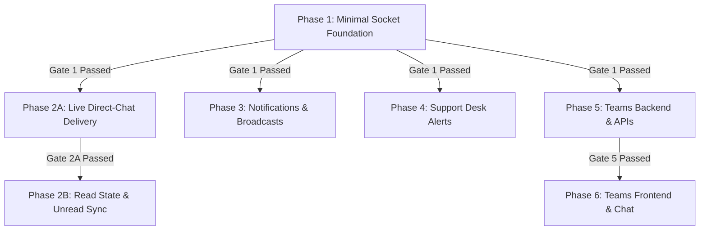

# ZYNC Real-Time Architecture & Implementation Specification (Reconciled Candidate)

> **Document Status:** Authoritative Reconciled Technical Architecture & Implementation Plan (Pre-Implementation Final Review)  
> **Repository Root:** `D:\Zync`  
> **Source Documents Harmonized:**  
> - `docs/REALTIME_ARCHITECTURE_PLAN.md` (Original Architecture Specification)  
> - Claude Specification ("ZYNC Real-Time Architecture & Implementation Specification", 26 pages)  
> - Verified ZYNC Repository Codebase (`backend/src`, `backend/test`, `frontend/src`)  
> **Current Repository Test Baseline:** 19 Test Suites, 317 Tests Passing (`npm test -- --fileParallelism=false` in `backend/`, duration ~46s). Total files in `backend/test`: 20 JavaScript files (19 `*.test.js` test suites + 1 `setup.js` test configuration helper). An earlier reference to "20 test files / 367 tests" has an unverified cause in the absence of historical test logs or repository evidence; in the active worktree and branch, the authoritative verified baseline is strictly 19 suites / 317 tests. *(Note: This baseline verifies existing REST endpoints and database models; it does not prove the proposed real-time socket architecture works).*  
> **Operating Constraint:** Planning & Specification Only. No source code, tests, package manifests, configurations, database data, or Git state modified without explicit user authorization. The uncommitted change in `backend/test/cors.test.js` is preserved exactly.

---

## Evidence & Claim Classification Standard
To ensure technical rigor, every assertion, invariant, and design element throughout this specification is tagged with one of three verifiable classifications:
- `[Repository-Verified]`: Directly confirmed by existing code, configuration files, model schemas, route handlers, or test suites in `d:\Zync`.
- `[Proposed]`: Architectural structures, code routines, event schemas, or tests designed for implementation in Phases 1 through 6.
- `[Unverified / Operational Assumption]`: Infrastructure or deployment factors external to the local repository (e.g., production proxy hop count, production MongoDB clustering topology).

---

## Table of Contents
1. [Executive Summary & Architectural Baseline](#1-executive-summary--architectural-baseline)
2. [Repository Audit: Verified Facts & Invariants](#2-repository-audit-verified-facts--invariants)
3. [Target REST + Socket.IO Architecture](#3-target-rest--socketio-architecture)
4. [Canonical Event Contracts & Room Topology](#4-canonical-event-contracts--room-topology)
5. [Authentication, Connection Security & Handshake Throttling](#5-authentication-connection-security--handshake-throttling)
6. [Live Authorization Synchronization & Eviction](#6-live-authorization-synchronization--eviction)
7. [Read State, Ordering Mechanics & Legacy Migration](#7-read-state-ordering-mechanics--legacy-migration)
8. [Event Delivery Guarantees, Reconnection & Catch-Up](#8-event-delivery-guarantees-reconnection--catch-up)
9. [Teams Domain Architecture](#9-teams-domain-architecture)
10. [Phase 1: Minimal Real-Time Foundation](#10-phase-1-minimal-real-time-foundation)
11. [Comprehensive Phased Roadmap (Phases 1 - 6)](#11-comprehensive-phased-roadmap-phases-1---6)
12. [Testing, Verification & Teardown Strategy](#12-testing-verification--teardown-strategy)
13. [Decisions, Trade-offs & Deferred Work](#13-decisions-trade-offs--deferred-work)
14. [Dependency Flow & Decision Gates](#14-dependency-flow--decision-gates)
15. [Pre-Implementation Checklist](#15-pre-implementation-checklist)

---

## 1. Executive Summary & Architectural Baseline

`[Repository-Verified]` ZYNC is a teammate-matching and gaming collaboration web platform (supporting BGMI, Brawl Stars, and Valorant) built on a React 19 frontend, an Express 5 backend, MongoDB (Mongoose 9), and Firebase Authentication.

`[Proposed]` This specification governs the transition of ZYNC from an HTTP polling model (`setInterval` polling every 3,000ms in `Chat.jsx`) to an event-driven real-time push architecture using **Socket.IO**.

### Core Architectural Mandates
1. **Authoritative REST Mutation Path** `[Proposed]`: All database writes, input sanitization, rate limiting, and business validation remain strictly executed by Express REST endpoints. Socket.IO is an ephemeral post-persistence push pipeline. Sockets never write to MongoDB.
2. **Zero Client-Trust Room Model** `[Proposed]`: Clients never specify arbitrary room subscriptions. Personal, official, team, and staff communication rooms are assigned strictly server-side using a consolidated `desiredRooms(profile, teamIds)` policy evaluated upon cryptographic authentication and live synchronization.
3. **Partitioned Direct & Moderation Chat Routing** `[Proposed]`:
   - Ordinary direct-chat messages route strictly to the participants' personal social rooms (`user:<profileId>`).
   - Moderation-chat messages (`isModeration: true`) route strictly to the participants' official rooms (`official:<profileId>`). Suspended accounts do not join `user:` rooms, completely isolating social traffic while preserving official appeal communications across all connected devices.
4. **REST-Driven Authorization Synchronization via `syncSocketRooms`** `[Proposed]`: Account status and role changes dynamically reconcile connected sockets via a centralized `syncSocketRooms(userId)` routine invoked post-save / post-commit by REST controllers (`adminController.updateUserStatus` and `adminController.createModerationAction`).
5. **Bounded Revocation Window & Best-Effort Eviction** `[Proposed]`: MongoDB is authoritative immediately upon transaction commit or document save. Socket room eviction is asynchronous and best-effort; failure to evict connected sockets is caught, logged, and does not convert successful REST mutations into HTTP 500 errors. Privileged socket handlers independently verify live status in MongoDB.
6. **Pre-Authentication Throttling & Trusted IP Resolution** `[Proposed]`: Connection handshake throttling runs before cryptographic Firebase token verification to protect backend resources. IP addresses are resolved using the Express application's verified trusted proxy configuration without blindly trusting arbitrary `X-Forwarded-For` headers.
7. **Resilient Reconnection Catch-Up & Reset Contract** `[Proposed]`: Socket.IO is not a durable event broker. Offline users and reconnecting clients recover persisted messages through authoritative REST endpoints using a compound `(createdAt, _id)` cursor with explicit incremental (`reset: false`) and gap-recovery baseline (`reset: true`) semantics.

---

## 2. Repository Audit: Verified Facts & Invariants

An exhaustive read-only audit of the ZYNC repository was performed across models, controllers, middleware, routes, frontend services, and test suites.

### 2.1 Verified Repository Facts
- **Module System & Package Manifests** `[Repository-Verified]`:
  - `backend/package.json` specifies `"type": "module"`. Standard ES `import`/`export` syntax is used throughout.
  - Dependencies: Express `^5.2.1`, Mongoose `^9.10.1`, Firebase Admin `^14.4.0`, CORS `^2.8.6`, Dotenv `^18.0.0`.
  - Frontend (`frontend/package.json`): React `^19.0.0`, React Router DOM `^7.1.5`, Firebase `^12.8.0`.
- **Authentication & User Profile** `[Repository-Verified]`:
  - Frontend (`frontend/src/context/AuthContext.jsx`) uses Firebase Client SDK v12 for email/password and Google OAuth popup sign-in.
  - Backend (`backend/src/middleware/authMiddleware.js`) verifies Bearer tokens using Firebase Admin SDK v14: `import admin from '../config/firebase-admin.js'; await admin.auth().verifyIdToken(token)`.
  - `backend/src/config/firebase-admin.js:L31-35` exports `export default admin;` where `admin = { auth: () => getAuth(firebaseApp) }`. **It has no named export `auth`**.
  - `UserProfile` model (`backend/src/models/UserProfile.js`) indexes users by `firebaseUid` (unique). The role enum is `['user', 'super_admin']` (default `'user'`), and the account status enum is `['active', 'suspended']` (default `'active'`).
  - `adminMiddleware.js` verifies `userProfile.role === 'super_admin'`. `activeMiddleware.js` rejects suspended users with `403 ACCOUNT_SUSPENDED`.
- **Account Status Mutation Paths** `[Repository-Verified]`:
  - **Path 1**: `PUT /api/admin/users/:id/status` (in `backend/src/controllers/adminController.js:L117-144`, `updateUserStatus`). Validates status, prevents self-suspension, sets `targetUser.accountStatus = status; await targetUser.save();`, and responds with status 200 and `{ message: \`User status updated to ${status}\`, user: targetUser }`.
  - **Path 2**: `POST /api/admin/moderation-actions` (in `backend/src/controllers/adminController.js:L373-535`, `createModerationAction`). For `actionType === 'temporary_suspension' || actionType === 'permanent_suspension'`, mutates `affectedUser.accountStatus = 'suspended'` inside a MongoDB transaction (`await affectedUser.save({ session })`), committing via `await session.commitTransaction()`.
  - **Expiry Fact**: `ModerationAction.js` tracks `expiresAt`, but the codebase currently contains no automated cron job or scheduled task that expires suspensions back to active. Status reversion currently occurs through `updateUserStatus`.
  - **Role Mutations**: No REST endpoint exists for role promotion/demotion. Super Admin is provisioned via seeding or `backend/scripts/bootstrap-admin.js`.
- **CORS Configuration & Security Model** `[Repository-Verified]`:
  - `backend/src/config/cors.js` defines `getAllowedOrigins(env)` and `getCorsOptions(env)`.
  - `credentials` is explicitly set to `false`.
  - `backend/test/cors.test.js:L210-216` verifies that `Access-Control-Allow-Credentials` is **not** sent because ZYNC uses Bearer tokens and no session cookies.
  - `[Proposed]` Socket.IO CORS configuration must reuse `getAllowedOrigins()` with `credentials: false`.
- **Direct & Moderation Chat** `[Repository-Verified]`:
  - `Conversation` (`backend/src/models/Conversation.js`): `participants` (array of 2 `UserProfile` ObjectIds), `lastMessage` (ref `Message`), `lastMessageAt` (Date), `isModeration` (Boolean).
  - In `backend/src/controllers/chatController.js`, conversation lookups strictly enforce two participants: `participants: { $all: [currentUser._id, targetUserId], $size: 2 }`.
  - Ordinary chat requires an accepted connection (`checkAcceptedConnection`) and active status.
  - Moderation chat permits suspended users to communicate with Super Admins only if prior appeal provenance exists (`Message.exists`, `ModerationAction.exists`, or `Report.exists` per `chatController.js:L237-246`). Active users are blocked from direct chat with Super Admins.
  - `Message` (`backend/src/models/Message.js`): `conversationId`, `sender`, `senderRole`, `senderDisplayName`, `text`. `timestamps: true` adds `createdAt` and `updatedAt`.
  - **Index status** `[Repository-Verified]`: `Message.js` currently only indexes `conversationId: { index: true }`. A compound index `{ conversationId: 1, createdAt: 1, _id: 1 }` must be added in Phase 2A to support efficient cursor pagination.
- **Notifications & Support** `[Repository-Verified]`:
  - `Notification` (`backend/src/models/Notification.js`): `recipient`, `broadcastId`, `title`, `message`, `read`. Index: `{ recipient: 1, createdAt: -1 }`.
  - `SupportTicket` (`backend/src/models/SupportTicket.js`): `ticketNumber`, `creator`, `category`, `status`, `priority`, `assignedStaff`, `messages`, `internalNotes`. `toUserDTO()` omits internal notes; `toStaffDTO()` retains them.
  - Suspended users are restricted to `suspension_appeal` and `account_access` categories (`supportController.js:L113-117`).
- **Teams** `[Repository-Verified]`:
  - `Team` (`backend/src/models/Team.js`): `name`, `game` (`'BGMI'`, `'Brawl Stars'`, `'Valorant'`), `captain` (ref `UserProfile`), `members` (array of refs to `UserProfile`).
  - `UserProfile.js:L66-69` maintains `teams: [{ type: ObjectId, ref: 'Team' }]`.
  - **No backend routes, controllers, invitation systems, or frontend pages exist for Teams.**
- **Application Factory, Proxy & Test Baseline** `[Repository-Verified]`:
  - `backend/src/app.js` exports `createApp(customCorsOptions, customTrustProxy)` and `default app = createApp()`.
  - `app.js:L27-34` resolves `trust proxy`: defaults to `1` (single reverse proxy hop) or respects `process.env.TRUST_PROXY`.
  - Test baseline: 19 test suite files (`*.test.js`), 317 tests passing via `npm test -- --fileParallelism=false` in `backend/` (~46s). Directory `backend/test/` contains 20 `.js` files in total (19 suites + 1 `setup.js` configuration helper).

---

## 3. Target REST + Socket.IO Architecture

```
                           ┌─────────────────────────────────────────┐
                           │       Client Browser / React 19         │
                           └───────┬─────────────────────────▲───────┘
                                   │                         │
                   1. HTTPS REST   │                         │ 4. WebSocket Push
                   (Auth, Mutate,  │                         │    (chat:message,
                    Rate Limit)    │                         │     notification:new,
                                   ▼                         │     account:status_changed)
                     ┌──────────────────────────┐            │
                     │     Express REST API     │            │
                     └─────────────┬────────────┘            │
                                   │                         │
                           2. Write & Validate               │
                                   ▼                         │
                     ┌──────────────────────────┐            │
                     │     MongoDB Database     │            │
                     └─────────────┬────────────┘            │
                                   │                         │
                           3. Trigger Dispatch               │
                              (Post-Save Async)              │
                                   ▼                         │
                     ┌──────────────────────────┐            │
                     │     Socket.IO Server     │────────────┘
                     │  (Personal/Room Routing) │
                     └──────────────────────────┘
```

### 3.1 Division of Responsibilities
| Concern | REST API (Express 5) `[Repository-Verified]` | Real-Time Push (Socket.IO) `[Proposed]` |
| :--- | :--- | :--- |
| **Authentication** | Bearer token verified per HTTP request | Firebase ID token verified during handshake |
| **Mutations** | Authoritative: all writes pass through REST | None: sockets do not execute database mutations |
| **Rate Limiting** | Strict in-memory sliding window per endpoint | Pre-auth handshake throttling (IP sliding window) |
| **Validation** | Schema, body length, enum, and role checks | None: receives sanitized payloads post-save |
| **Persistence** | Synchronous writes to MongoDB database | None: ephemeral in-memory event dispatch |
| **Authorization Sync** | Triggers `syncSocketRooms` asynchronously post-DB write | Reconciles connected socket rooms via `desiredRooms(profile)` |
| **Event Dispatch** | Triggers socket broadcast after DB write | Dispatches events to pre-authorized rooms |
| **History Catch-up** | Authoritative paginated recovery endpoints (`after`/`before`) | None: does not store or replay past events |

---

## 4. Canonical Event Contracts & Room Topology

### 4.1 Server-Controlled Room Topology
`[Proposed]` Clients never issue room-join requests. Rooms are partitioned into **four server-assigned categories**:
1. `user:<profileId>`: The **personal social room**. Assigned automatically at handshake to active accounts. Delivers direct chat messages, friend requests, and social updates.
2. `official:<profileId>`: The **personal official room**. Assigned automatically at handshake to both active and suspended accounts. Delivers moderation notices, suspension warnings, moderation chat, support ticket updates, appeal replies, and `team:removed`.
3. `team:<teamId>`: The **squad team room**. Joined only after server-side verification against `Team.members` via `desiredRooms`. Delivers squad group chat and roster updates.
4. `admin:staff`: The **privileged staff desk room**. Assigned strictly server-side to verified, **active** `super_admin` accounts. Delivers real-time ticket desk and report desk alerts.

### 4.2 Canonical Event Contract Table `[Proposed]`

| Event Name | Direction | Target Room | Payload Contract | Authorization & Delivery Rule |
| :--- | :--- | :--- | :--- | :--- |
| `chat:message` | Server -> Client | Ordinary: `user:<recipientId>` & `user:<senderId>`<br>Moderation: `official:<recipientId>` & `official:<senderId>` | `{ _id, conversationId, sender, senderRole, senderDisplayName, text, createdAt, isModeration }` | Ordinary: Active accepted friends only.<br>Moderation: Routed strictly to `official:` rooms, enabling suspended users to participate across all tabs while isolating social rooms. |
| `chat:read_receipt` | Server -> Client | Ordinary: `user:<otherParticipantId>`<br>Moderation: `official:<otherParticipantId>` | `{ conversationId, readerId, lastReadMessageId, lastReadAt }` | Emitted only when read cursor actually advances (`modifiedCount > 0`). Delivered to other participant's room to update checkmarks. |
| `user:read_state` | Server -> Client | Ordinary: `user:<readerId>`<br>Moderation: `official:<readerId>` | `{ conversationId, lastReadMessageId, lastReadAt }` | Emitted only when read cursor advances (`modifiedCount > 0`). Synchronizes read badges across all open tabs/devices of the reader. |
| `notification:new` | Server -> Client | `user:<recipientId>` | `{ _id, title, message, read, createdAt }` | Active users only. Social/connection alerts. |
| `moderation:notice` | Server -> Client | `official:<recipientId>` | `{ actionId, actionType, reason, expiresAt, createdAt }` | Available to active and suspended users. Official administrative notices. |
| `support:ticket_reply` | Server -> Client | User: `official:<creatorId>`<br>Staff: `admin:staff` | User: `ticket.toUserDTO().messages[latest]` (omits internal notes)<br>Staff: `ticket.toStaffDTO().messages[latest]` | Delivered to creator via `official:` and to staff via `admin:staff`. User payload strictly omits staff notes. |
| `support:ticket_updated` | Server -> Client | User: `official:<creatorId>`<br>Staff: `admin:staff` | User: `ticket.toUserDTO()` meta<br>Staff: `ticket.toStaffDTO()` meta | Emitted on status, priority, or assignee change. User payload sanitizes internal notes. |
| `support:internal_note` | Server -> Client | `admin:staff` | Latest note from `ticket.toStaffDTO()` | Confined strictly to `admin:staff`. Never emitted to user rooms. |
| `support:desk_alert` | Server -> Client | `admin:staff` | `{ ticketId, ticketNumber, category, priority, subject, creatorEmail }` | Strictly verified, active `super_admin` staff. |
| `account:status_changed` | Server -> Client | `official:<userId>` | `{ accountStatus: 'suspended' \| 'active' }` | Emitted only when status actually changes (`previousStatus !== profile.accountStatus`). Triggers client UI route adjustments. |
| `team:message` | Server -> Client | `team:<teamId>` | `{ _id, teamId, sender, text, createdAt }` | Active members in `Team.members` only. |
| `team:removed` | Server -> Client | `official:<userId>` | `{ teamId, reason: 'kicked' \| 'disbanded' \| 'left' }` | Routed through `official:` room so it reaches suspended users as well. |

---

## 5. Authentication, Connection Security & Handshake Throttling

### 5.1 Handshake Authentication & Identity Resolution `[Proposed]`
Identity must be derived strictly on the server from the Firebase ID token:
```
[ Client Handshake ] ──> auth: { token: "<Firebase ID Token>" }
                               │
                               ▼
               [ 1. Handshake Rate Limiter ]
                 (Enforced in socketAuth.js before token verification)
                               │
                               ▼
               [ 2. Token & Profile Verification ]
                               │
             admin.auth().verifyIdToken(token)
                               │ (Extracts decoded.uid)
                               ▼
        UserProfile.findOne({ firebaseUid: decoded.uid })
                               │
        ┌──────────────────────┴──────────────────────┐
        │ Profile Not Found                           │ Profile Found
        ▼                                             ▼
reject(new Error('Profile not found'))     socket.data.user = {
                                             uid: decoded.uid,
                                             profileId: userProfile._id.toString(),
                                             role: userProfile.role,
                                             accountStatus: userProfile.accountStatus
                                           }
                                                      │
                                                      ▼
                                       Join initial desiredRooms(userProfile)
                                       - Always: official:<profileId>
                                       - If active: user:<profileId>
                                       - If active + super_admin: admin:staff
```

### 5.2 Handshake Error Surface `[Proposed]`
Socket.IO handshake failures are surfaced to clients as `connect_error` events containing an `Error` object, **not HTTP status codes**:
- If rate limited: `connect_error` with `message: 'Too many connection attempts. Please slow down.'`.
- If token is missing: `connect_error` with `message: 'Unauthorized: No token provided'`.
- If token is invalid or expired: `connect_error` with `message: 'Unauthorized: Invalid token'`.
- If MongoDB profile is missing: `connect_error` with `message: 'Profile not found'`.

### 5.3 Bounded Frontend Reconnect & Token Refresh `[Proposed]`
The frontend `SocketContext` implements bounded reconnect behavior to prevent runaway retry loops:
- Uses dynamic auth callback:
  ```javascript
  auth: (cb) => {
    if (!currentUser) return cb({ token: null });
    currentUser.getIdToken()
      .then(token => cb({ token }))
      .catch(() => cb({ token: null }));
  }
  ```
- If `connect_error` indicates an expired or invalid token, the client calls `currentUser.getIdToken(true)` to obtain a fresh token from Firebase and invokes `socket.connect()` to retry.
- Reconnection attempts are bounded: after 3 consecutive authentication failures, retries halt and surface an authentication error to the user interface.
- On `logout()`, the client calls `socket.disconnect()` and clears state.

### 5.4 Partitioning for Suspended Accounts `[Proposed]`
- Suspended users connect successfully, but **do not join `user:${profileId}`** or any `team:*` rooms. They join only `official:${profileId}`.
- Because social notifications and ordinary chat messages are emitted strictly to `user:${recipientId}`, suspended accounts are physically incapable of receiving social events.
- Moderation conversations and support ticket replies are emitted strictly to `official:${profileId}`, preserving essential communication channels across all connected tabs.

### 5.5 Handshake Throttling & Trusted Client-IP Resolution

#### 1. Execution Precedence `[Proposed]`
The handshake limiter runs **before** Firebase `verifyIdToken()` executes. This avoids burning CPU and external network quota on unauthenticated connection floods.

#### 2. Express `trust proxy` Verification vs. Socket.IO Resolution `[Repository-Verified & Proposed]`
- `[Repository-Verified]` In Express (`backend/src/app.js:L27-34`), `trust proxy` is set via:
  ```javascript
  const envTrustProxy = process.env.TRUST_PROXY;
  const resolvedTrustProxy = customTrustProxy !== undefined
    ? customTrustProxy
    : (envTrustProxy !== undefined
      ? (envTrustProxy === 'true' ? true : envTrustProxy === 'false' ? false : !isNaN(Number(envTrustProxy)) ? Number(envTrustProxy) : envTrustProxy)
      : 1);
  app.set('trust proxy', resolvedTrustProxy);
  ```
- `[Repository-Verified]` In Socket.IO middleware, `socket.request` is a raw Node `http.IncomingMessage`. It does **not** have the Express `req.ip` getter.
- `[Proposed - Scope, Deployment Assumptions & Non-Parity Notice]` Express delegates IP evaluation to `proxy-addr`, which supports CIDR subnets (`'loopback'`, `'10.0.0.0/8'`), IP lists, arrays, and custom trust functions. The lightweight resolver below **does not claim full Express/proxy-addr parity**. Instead:
  - **Maintained IP Parser**: The implementation strictly uses Node's standard library `net.isIP(str)` (`import net from 'node:net'`), completely avoiding fragile hand-rolled regular expressions. `net.isIP` natively accepts all standard and compressed IPv6 forms (e.g. `::1`, `2001:db8::1`, `fe80::1ff:fe23:4567:890a`) as well as valid IPv4 addresses.
  - **Preserving Forwarding Chain Positions**: The resolver **never filters out invalid entries before calculating hop index positions**. Filtering shrinks the array and shifts the relative index from the trusted proxy, potentially selecting a client-spoofed entry instead of the genuine client. Hops are indexed directly against the raw split entries.
  - **Fail-Safe Port Parsing**: Strips port numbers from IPv4 (`198.51.100.1:8080` -> `198.51.100.1`) and bracketed IPv6 (`[2001:db8::1]:8080` -> `2001:db8::1`). If bracket syntax or port numbers are malformed, extraction fails safe.
  - **Hop-Count & Chain Integrity Verification**: If `trustProxy` is an integer $N$, the client candidate is located at `rawEntries.length - N`. If `rawEntries.length < N` (fewer hops than expected trusted proxies), the chain is truncated and fails safe to `peer`. Furthermore, all upstream proxy hops between the candidate and the server must be valid IPs; any malformed intermediate hop invalidates the chain and triggers fail-safe fallback to `peer`.
  - **Insecure Configuration Warning (`trustProxy: true`)**: `trustProxy === true` trusts all proxies unconditionally and selects the leftmost entry (`rawEntries[0]`). In untrusted client-facing environments, this address is trivially spoofable by an attacker prepending arbitrary headers. It is supported strictly for local development/test parity and is strongly discouraged for production rate limiting.
  - **Unsupported Trust Configurations**: If `trustProxy` is a string (e.g. `'loopback'`, `'10.0.0.0/8'`), an array of subnets, or a custom function, the resolver logs a startup warning and fails safe directly to `socket.handshake.address` (the direct TCP peer). It never throws or assumes unverified headers.

```javascript
import net from 'node:net';

/**
 * Validates whether a given string is a syntactically valid IPv4 or IPv6 address.
 * Uses Node standard library net.isIP (returns 4, 6, or 0).
 *
 * @param {string} ip
 * @returns {boolean}
 */
export const isValidIp = (ip) => {
  if (typeof ip !== 'string') return false;
  return net.isIP(ip.trim()) !== 0;
};

/**
 * Strips port numbers and brackets from an IP string candidate.
 * Handles:
 * - Bare IPv4: "198.51.100.1" -> "198.51.100.1"
 * - IPv4 with port: "198.51.100.1:8080" -> "198.51.100.1"
 * - Bare IPv6: "2001:db8::1" or "::1" -> "2001:db8::1" or "::1"
 * - Bracketed IPv6 with port: "[2001:db8::1]:8080" -> "2001:db8::1"
 * - Bracketed IPv6 without port: "[2001:db8::1]" -> "2001:db8::1"
 * Returns null if the value is malformed or invalid.
 *
 * @param {string} entry
 * @returns {string|null} Cleaned IP string or null if invalid
 */
export const stripPortAndBrackets = (entry) => {
  if (typeof entry !== 'string') return null;
  const cleaned = entry.trim();
  if (!cleaned) return null;

  // 1. Bracketed IPv6 notation: [2001:db8::1]:port or [2001:db8::1]
  if (cleaned.startsWith('[')) {
    const closeBracket = cleaned.indexOf(']');
    if (closeBracket === -1) return null; // Malformed brackets

    const innerIp = cleaned.substring(1, closeBracket);
    if (net.isIP(innerIp) !== 6) return null; // Inner content must be valid IPv6

    const suffix = cleaned.substring(closeBracket + 1);
    if (suffix === '') return innerIp; // No port

    // Must be :port where port is 1-65535
    if (/^:\d{1,5}$/.test(suffix)) {
      const port = Number(suffix.substring(1));
      if (port >= 1 && port <= 65535) return innerIp;
    }
    return null; // Malformed port suffix
  }

  // 2. Bare IP address (IPv4 or unbracketed IPv6)
  if (net.isIP(cleaned) !== 0) {
    return cleaned;
  }

  // 3. IPv4 with port: exactly one colon separating IPv4 and valid port
  const colonCount = (cleaned.match(/:/g) || []).length;
  if (colonCount === 1) {
    const [ipPart, portPart] = cleaned.split(':');
    if (net.isIP(ipPart) === 4 && /^\d{1,5}$/.test(portPart)) {
      const port = Number(portPart);
      if (port >= 1 && port <= 65535) return ipPart;
    }
  }

  return null;
};

/**
 * Resolves client IP from Socket.IO handshake adhering to supported trust proxy settings.
 * Fails safe to handshake.address on unsupported settings, malformed chains, or spoofed headers.
 * Does NOT filter invalid entries prior to index calculation to preserve hop alignment.
 * 
 * @param {Object} handshake - socket.handshake
 * @param {boolean|number|string} trustProxy - resolved trust proxy setting from Express
 * @returns {string} resolved client IP address
 */
export const resolveClientIp = (handshake, trustProxy) => {
  const peer = handshake?.address || '127.0.0.1'; // direct TCP peer

  // 1. Direct connection or proxy trust disabled
  if (trustProxy === false || trustProxy === 0) {
    return peer;
  }

  // 2. Unsupported configurations (strings/subnets, arrays, functions) -> fail safe to direct peer
  if (typeof trustProxy === 'string' || typeof trustProxy === 'function' || Array.isArray(trustProxy)) {
    return peer;
  }

  // 3. Evaluate hop count
  const isAllTrusted = trustProxy === true;
  const hops = isAllTrusted 
    ? Infinity 
    : Number.isInteger(trustProxy) && trustProxy > 0 
      ? trustProxy 
      : 0;

  if (hops === 0) return peer;

  const rawHeader = handshake?.headers?.['x-forwarded-for'];
  if (!rawHeader) return peer;

  // Handle multiple headers or comma-separated list
  const headerStr = Array.isArray(rawHeader) ? rawHeader.join(',') : String(rawHeader);
  if (!headerStr.trim()) return peer;

  // Split into raw entries WITHOUT pre-filtering to preserve position
  const rawEntries = headerStr.split(',');

  // Case A: trustProxy = true (Trust all hops -> leftmost entry)
  if (isAllTrusted) {
    const candidate = stripPortAndBrackets(rawEntries[0]);
    return candidate !== null ? candidate : peer;
  }

  // Case B: Integer hops = N
  // With N trusted hops, candidate is the Nth entry from the right
  const targetIdx = rawEntries.length - hops;

  // If chain has fewer entries than expected trusted hops, the chain is truncated/malformed
  if (targetIdx < 0) {
    return peer;
  }

  // Chain integrity check: all intermediate trusted proxy hops to the right must be valid IPs
  for (let i = targetIdx + 1; i < rawEntries.length; i++) {
    const proxyHop = stripPortAndBrackets(rawEntries[i]);
    if (!proxyHop) {
      return peer; // Malformed intermediate hop breaks chain trust
    }
  }

  // Extract and clean candidate client IP
  const candidate = stripPortAndBrackets(rawEntries[targetIdx]);
  return candidate !== null ? candidate : peer;
};
```

#### Test Specifications for Client-IP Resolution (`socketAuth.test.js`) `[Proposed]`
Automated unit tests must be added to verify all edge cases:
1. **Valid Compressed IPv6**: `X-Forwarded-For: "::1"` and `"2001:db8::1"` resolve accurately without regex truncation.
2. **IPv4 with Port**: `X-Forwarded-For: "203.0.113.195:443"` resolves to `"203.0.113.195"`.
3. **Bracketed IPv6 with Port**: `X-Forwarded-For: "[2001:db8::1]:8080"` resolves to `"2001:db8::1"`.
4. **Malformed Mixed Chains**: `X-Forwarded-For: "198.51.100.1, not-an-ip, 203.0.113.195"` with `trustProxy = 1`:
   - Raw chain length is 3; candidate index is $3 - 1 = 2$ (`"203.0.113.195"`).
   - If pre-filtered, length would shrink to 2, selecting position 1 (`"not-an-ip"` or shifted). The unfiltered implementation correctly selects `"203.0.113.195"`.
5. **Intermediate Malformed Hop**: `X-Forwarded-For: "198.51.100.1, malformed-proxy, 203.0.113.195"` with `trustProxy = 2`:
   - Intermediate proxy at index 2 is verified. If index 2 or 1 is malformed, fails safe to direct peer.
6. **Spoofed Forwarding Headers**: `X-Forwarded-For: "spoofed.client.ip, 198.51.100.1"` with `trustProxy = 1`:
   - Correctly selects `"198.51.100.1"` (the hop directly upstream from the single trusted proxy), ignoring the prepended spoofed address.
7. **Unsupported Trust Configurations**:
   - `trustProxy = 'loopback'`, `trustProxy = ['10.0.0.0/8']`, `trustProxy = () => true` log a warning and return direct peer `handshake.address`.
8. **Truncated Chain**: `X-Forwarded-For: "198.51.100.1"` with `trustProxy = 2`:
   - Chain length 1 is less than 2 hops; fails safe to direct peer `handshake.address`.

#### 3. Limiter Specifications `[Proposed]`
- **Authoritative Module**: `backend/src/socket/socketAuth.js` as `createHandshakeLimiter`.
- **Limit**: 60 connection attempts per minute per resolved IP (in-memory sliding window).
- **Cleanup & Memory Bounding**: Expired timestamps are pruned periodically (interval or when tracker exceeds 500 entries) to prevent memory leaks.
- **Topology Limitation** `[Unverified / Operational Assumption]`: This in-memory limiter is designed for single-process deployments. In a multi-instance cluster behind a load balancer, connection throttling must migrate to a shared Redis store or API gateway.
- **Rejection Contract**: Exceeded limits immediately invoke `next(new Error('Too many connection attempts. Please slow down.'))`.

---

## 6. Live Authorization Synchronization & Eviction

### 6.1 Consolidated Room Policy: `desiredRooms(profile, teamIds)` `[Proposed]`
To eliminate discrepancies between initial handshake joins and subsequent synchronization, a single pure policy function defines all authorized rooms for a profile:

```javascript
/**
 * Authoritative room policy mapping a UserProfile to its permitted Socket.IO rooms.
 * Used by BOTH initial connection handler and syncSocketRooms().
 *
 * @param {Object|null} profile - Mongoose UserProfile document or lean object
 * @param {Array<string>|null} teamIds - Optional array of team IDs for the user
 * @returns {Set<string>|null} Set of permitted room names, or null if profile deleted/missing
 */
export const desiredRooms = (profile, teamIds = []) => {
  if (!profile) return null; // Signals deletion: disconnect all sockets

  const rooms = new Set();
  const profileId = profile._id.toString();
  const isActive = profile.accountStatus === 'active';

  // 1. Official room: assigned to all existing accounts (active and suspended)
  rooms.add(`official:${profileId}`);

  // 2. Personal social room: active accounts only
  if (isActive) {
    rooms.add(`user:${profileId}`);
  }

  // 3. Staff room: super_admin who is ALSO active
  // A suspended super_admin must lose staff-desk access
  if (isActive && profile.role === 'super_admin') {
    rooms.add('admin:staff');
  }

  // 4. Team rooms (Phase 5): active users only
  if (isActive && Array.isArray(teamIds)) {
    for (const tid of teamIds) {
      rooms.add(`team:${tid.toString()}`);
    }
  }

  return rooms;
};
```

### 6.2 Direct Connection Reconciliation & Handshake Race Closure `[Proposed]`

#### The Flaw in Assuming `syncSocketRooms` Finds Connecting Sockets
`syncSocketRooms(userId)` queries `io.in('official:' + id).fetchSockets()`.
If a socket is currently in the handshake pipeline or has just connected, it has not yet joined `official:${id}`. If an admin mutates status during that exact window, `fetchSockets()` will **miss the connecting socket**.

#### Solution: Direct Per-Socket Reconciliation on Connection
The `connection` event handler must **not** rely on `syncSocketRooms` to find it. Instead, it directly reconciles the connecting `socket` instance against fresh database state:

```javascript
// In backend/src/socket/index.js connection handler
io.on('connection', async (socket) => {
  const user = socket.data?.user;
  if (!user) return socket.disconnect(true);

  // Preserve handshake values as immutable primitives before any socket mutations
  const handshakeStatus = user.accountStatus;
  const handshakeRole = user.role;

  try {
    // 1. Always join personal official room first
    socket.join(`official:${user.profileId}`);

    // 2. Fetch fresh profile directly from MongoDB at connection time
    const freshProfile = await UserProfile.findById(user.profileId).select('role accountStatus');
    if (!freshProfile) {
      // User was deleted between handshake and connection
      return socket.disconnect(true);
    }

    // 3. If in Phase 5, query team memberships
    let teamIds = [];
    if (freshProfile.accountStatus === 'active') {
      const teams = await Team.find({ members: freshProfile._id }).select('_id');
      teamIds = teams.map(t => t._id);
    }

    // 4. Update live socket.data with fresh DB state
    socket.data.user.role = freshProfile.role;
    socket.data.user.accountStatus = freshProfile.accountStatus;

    // 5. Compute target rooms from fresh DB state and join directly
    const targetRooms = desiredRooms(freshProfile, teamIds);
    for (const room of targetRooms) {
      socket.join(room);
    }

    // 6. Post-Join Status & Team Verification Guard (Closes connection/suspension and connection/kick races)
    // If an admin suspended or kicked the user while connection setup was in-flight,
    // re-verify live state post-join to ensure no stale social or team rooms are retained:
    let finalStatus = freshProfile.accountStatus;
    if (freshProfile.accountStatus === 'active') {
      const postJoinCheck = await UserProfile.findById(user.profileId).select('role accountStatus');
      if (!postJoinCheck || postJoinCheck.accountStatus !== 'active') {
        finalStatus = postJoinCheck?.accountStatus || 'suspended';
        socket.data.user.accountStatus = finalStatus;

        // Evict immediately from all managed rooms except official:
        for (const room of [...socket.rooms]) {
          if (MANAGED_PREFIXES.some(prefix => room.startsWith(prefix))) {
            socket.leave(room);
          }
        }
      } else if (teamIds.length > 0) {
        // Re-verify team membership post-join
        const stillValidTeams = await Team.find({
          _id: { $in: teamIds },
          members: freshProfile._id
        }).select('_id');
        const validSet = new Set(stillValidTeams.map(t => t._id.toString()));

        for (const tid of teamIds) {
          const tidStr = tid.toString();
          if (!validSet.has(tidStr)) {
            socket.leave(`team:${tidStr}`);
            socket.emit('team:removed', { teamId: tidStr, reason: 'kicked' });
          }
        }
      }
    }

    // 7. Direct status-change notification:
    // Compare resolved finalStatus against the preserved immutable handshakeStatus
    if (finalStatus !== handshakeStatus) {
      socket.emit('account:status_changed', { accountStatus: finalStatus });
    }
  } catch (err) {
    console.error('[Socket] Direct connection reconciliation error:', err.message);
    socket.disconnect(true);
  }
});
```

### 6.3 Centralized `syncSocketRooms(userId)` Service `[Proposed]`
`backend/src/socket/socketService.js` reconciles all already-connected sockets of a user:

```javascript
const MANAGED_PREFIXES = ['user:', 'team:', 'admin:'];

/**
 * Reconciles all connected sockets for a given user against authoritative MongoDB state.
 * @param {string|ObjectId} userId - Target UserProfile ID
 */
export const syncSocketRooms = async (userId) => {
  if (!ioInstance) return;

  const id = userId.toString();

  // 1. Re-read authoritative profile from MongoDB (never trust socket.data)
  const profile = await UserProfile.findById(id).select('role accountStatus');
  const sockets = await ioInstance.in(`official:${id}`).fetchSockets();

  // 2. Profile deleted: disconnect every socket of this user
  if (!profile) {
    for (const socket of sockets) {
      socket.disconnect(true);
    }
    return;
  }

  // 3. Query active team memberships if user is active (Phase 5)
  let teamIds = [];
  if (profile.accountStatus === 'active') {
    const teams = await Team.find({ members: profile._id }).select('_id');
    teamIds = teams.map(t => t._id);
  }

  const targetRooms = desiredRooms(profile, teamIds);

  for (const socket of sockets) {
    const previousStatus = socket.data?.user?.accountStatus;

    if (socket.data?.user) {
      socket.data.user.role = profile.role;
      socket.data.user.accountStatus = profile.accountStatus;
    }

    // 4. Revoke: leave managed rooms that are no longer permitted
    // Iterate over a copy because leave() mutates socket.rooms
    for (const room of [...socket.rooms]) {
      if (room === socket.id || targetRooms.has(room)) continue;
      if (MANAGED_PREFIXES.some(prefix => room.startsWith(prefix))) {
        socket.leave(room);
      }
    }

    // 5. Grant: join any permitted room not yet joined
    for (const room of targetRooms) {
      if (!socket.rooms.has(room)) {
        socket.join(room);
      }
    }

    // 6. Notify only when the account status actually changed
    if (previousStatus !== profile.accountStatus) {
      socket.emit('account:status_changed', { accountStatus: profile.accountStatus });
    }
  }
};

/**
 * Evicts all connected sockets of a user from a specific team room.
 * Delivers team:removed notification over the authorized official: room.
 */
export const evictFromTeamRoom = async (userId, teamId, reason = 'kicked') => {
  if (!ioInstance) return;
  const sockets = await ioInstance.in(`official:${userId}`).fetchSockets();
  for (const socket of sockets) {
    socket.leave(`team:${teamId}`);
    socket.emit('team:removed', { teamId, reason }); // official: is always reachable
  }
};
```

### 6.4 Authorization as the Security Boundary & Revocation Limits `[Proposed]`

#### 1. Security Architecture: Authorization vs. Eviction
- **Authorization is the Core Security Boundary**:
  - The authoritative access boundary in ZYNC resides strictly in the REST API and database persistence layers.
  - The instant a MongoDB document save or transaction commits setting `accountStatus: 'suspended'` or removing a user from `Team.members`, **all subsequent REST requests are synchronously blocked** by `activeMiddleware.js` (`403 ACCOUNT_SUSPENDED`) or controller-level authorization checks.
  - The user is physically barred from submitting new chat messages, sending friend requests, creating support tickets (except appeals), or reading message history.
- **Room Eviction is Defense in Depth**:
  - Socket.IO room membership (`user:<id>`, `team:<id>`, `admin:staff`) is an ephemeral routing convenience designed to deliver push notifications to active participants.
  - Room eviction via `syncSocketRooms` and `evictFromTeamRoom` acts as defense in depth to stop subsequent events from being delivered to the revoked client.

#### 2. The Unavoidable Delivery Window & Revocation Timing
- Because MongoDB transaction commits and Socket.IO in-memory room management are distinct operations, eviction is executed asynchronously post-commit via `setImmediate`.
- **Explicitly Unmeasured, Non-Zero Delay**:
  - The delay between MongoDB commit and room eviction completion is **explicitly unmeasured and non-zero**. It varies based on event loop tick scheduling, async I/O dispatch, server CPU load, and Garbage Collection pauses. In a clustered deployment with a multi-node adapter, it additionally includes inter-process pub/sub latency.
- **Honest Security Assessment & Guarantee Distinction**:
  - **Asynchronous room eviction alone cannot guarantee zero post-revocation delivery**.
  - **REST Authorization Guarantee**: Synchronous and absolute. The instant a database mutation commits, no unauthorized write or read can occur via REST.
  - **Socket Event-Delivery Guarantee**: Ephemeral, best-effort push. Sockets do not provide transactional ACID boundaries. If another active user sends an ordinary chat message or team message during the non-zero window between MongoDB commit and room eviction completion, that in-flight message **will physically be delivered to the revoked user's connected socket** before eviction completes.
  - This possibility is **not harmless**: it represents an unavoidable brief data exposure window inherent to asynchronous post-persistence push architectures.
  - **Why this trade-off is accepted**: Eliminating this window completely would require Express REST mutation endpoints to synchronously halt, broadcast socket room evictions across all cluster nodes, wait for two-phase eviction confirmations from every connected socket adapter, and only then return `200 OK`. This introduces severe latency, cascading failure coupling, and distributed deadlock risks.
  - **Mitigation Stack**:
    1. Synchronous REST cutoff: Suspended users cannot fetch older history or reply.
    2. Event-loop immediacy: `setImmediate` executes eviction on the very next tick.
    3. Client-side response: The `account:status_changed` event instructs the client frontend to immediately clear local conversation state and route to `/account-suspended`.

---

## 7. Read State, Ordering Mechanics & Legacy Migration

### 7.1 Authoritative Message Ordering: Stable Compound Cursor `(createdAt, _id)` `[Proposed]`
- **Decision: Compound `(createdAt, _id)` Cursor**.  
  A message $M_2$ is strictly newer than $M_1$ if and only if:  
  `M2.createdAt > M1.createdAt || (M2.createdAt.getTime() === M1.createdAt.getTime() && M2._id > M1._id)`.
  - **Deterministic Total Ordering**: Guaranteed by MongoDB ObjectId uniqueness and timestamp component.
  - **Limitation & Ordering Semantics**: ObjectIds provide a deterministic total comparison order. However, across a distributed cluster with minor clock skew, ObjectId binary comparison does not guarantee true physical causal order for two messages created within the exact same second on different machines. This is accepted as standard for chat pagination.
  - **Zero Migration Overhead**: Requires no schema modifications or counter backfilling on existing `Message` documents.

### 7.2 Atomic Read-State Update with Compound Array Filters (Phase 2B) `[Proposed]`

#### 1. The Flaw in Independent Missing-ID Checks
In a naive `$or` filter, placing `{ 'elem.lastReadMessageId': null }` as an independent top-level branch allows any older message to match if the message ID was uninitialized or migrated from a legacy schema where only `lastReadAt` existed. If `lastReadAt` is already at `2026-10-22`, an incoming read receipt for an older message from `2026-10-01` would evaluate the null-ID branch to `true`, regressing `lastReadAt` backward and corrupting the unread horizon.

#### 2. Single Cursor-Ordering Invariant
A cursor state is defined as the tuple $C = (T, ID)$ where:
- $T$ = `lastReadAt` (`Date` or `null`)
- $ID$ = `lastReadMessageId` (`ObjectId` or `null`)

Target message is $M = (T_{msg}, ID_{msg}) = (\text{targetMessage.createdAt}, \text{targetMessage._id})$.

An update authorizes advancement if and only if $M$ is strictly newer than $C$ ($M > C$) under one of four mutually exclusive, exhaustive conditions:
1. **Condition 1 (Fully Uninitialized)**: Both $T$ and $ID$ are null or missing; OR
2. **Condition 2 (Timestamp Advancement)**: $T$ is present (non-null) and $T_{msg} > T$; OR
3. **Condition 3 (Equal Timestamp Tie-Break)**: $T$ is present (non-null), $T_{msg} == T$, AND ($ID$ is null/missing OR $ID_{msg} > ID$); OR
4. **Condition 4 (Message-ID-Only Advancement)**: $T$ is null or missing, $ID$ is present (non-null), AND $ID_{msg} > ID$.

Under all other conditions ($T_{msg} < T$, or $T_{msg} == T$ with $ID_{msg} \le ID$, or missing $T$ with $ID_{msg} \le ID$), the update is rejected (`modifiedCount === 0`) and emits zero socket events.

```javascript
// In chatController.js:markConversationAsRead (Phase 2B - DEFERRED)
const updateResult = await Conversation.updateOne(
  { _id: conversationId, 'readStatus.user': currentUser._id },
  {
    $set: {
      'readStatus.$[elem].lastReadMessageId': targetMessage._id,
      'readStatus.$[elem].lastReadAt': targetMessage.createdAt
    }
  },
  {
    arrayFilters: [
      {
        $and: [
          { 'elem.user': currentUser._id },
          {
            $or: [
              // Case 1: Fully uninitialized cursor (BOTH fields null or missing)
              {
                $and: [
                  { $or: [{ 'elem.lastReadAt': null }, { 'elem.lastReadAt': { $exists: false } }] },
                  { $or: [{ 'elem.lastReadMessageId': null }, { 'elem.lastReadMessageId': { $exists: false } }] }
                ]
              },
              // Case 2: Monotonic timestamp advancement (elem.lastReadAt is present and strictly older)
              {
                'elem.lastReadAt': { $exists: true, $ne: null, $lt: targetMessage.createdAt }
              },
              // Case 3: Equal timestamp tie-break via ObjectId
              // (elem.lastReadAt matches targetMessage.createdAt, and elem.lastReadMessageId is either missing/null or strictly older)
              {
                'elem.lastReadAt': targetMessage.createdAt,
                $or: [
                  { 'elem.lastReadMessageId': null },
                  { 'elem.lastReadMessageId': { $exists: false } },
                  { 'elem.lastReadMessageId': { $lt: targetMessage._id } }
                ]
              },
              // Case 4: Message-ID-only partial state (timestamp is missing/null, but message ID is present and strictly older)
              {
                $or: [{ 'elem.lastReadAt': null }, { 'elem.lastReadAt': { $exists: false } }],
                'elem.lastReadMessageId': { $exists: true, $ne: null, $lt: targetMessage._id }
              }
            ]
          }
        ]
      }
    ]
  }
);

// Emission Guard: Emit events ONLY if the cursor was actually advanced forward
if (updateResult.modifiedCount > 0) {
  const otherParticipantId = conversation.participants.find(p => !p.equals(currentUser._id));
  const emitTargetRoom = conversation.isModeration 
    ? `official:${otherParticipantId}` 
    : `user:${otherParticipantId}`;

  // Read receipt delivered to the OTHER participant
  emitToRoom(emitTargetRoom, 'chat:read_receipt', {
    conversationId,
    readerId: currentUser._id,
    lastReadMessageId: targetMessage._id,
    lastReadAt: targetMessage.createdAt
  });

  // Cross-device sync for the READER's own tabs
  const readerRoom = conversation.isModeration 
    ? `official:${currentUser._id}` 
    : `user:${currentUser._id}`;
  emitToRoom(readerRoom, 'user:read_state', {
    conversationId,
    lastReadMessageId: targetMessage._id,
    lastReadAt: targetMessage.createdAt
  });
}
```

#### 3. Normalization of Partially Initialized States
- **Partial State A (`lastReadAt` set, `lastReadMessageId` null/missing)**:
  - Target message with $T_{msg} < T$: Fails Case 1, fails Case 2 ($T_{msg} \not> T$), fails Case 3 ($T_{msg} \neq T$), fails Case 4 ($T$ is present). **Result: Strictly rejected (`modifiedCount === 0`)**, completely preventing backward cursor regression.
  - Target message with $T_{msg} == T$: Matches Case 3 via `{ 'elem.lastReadMessageId': null }`. **Result: Populates `lastReadMessageId`** and normalizes the cursor without regressing the timestamp (`modifiedCount === 1`).
  - Target message with $T_{msg} > T$: Matches Case 2. **Result: Advances `lastReadAt` to $T_{msg}$ and sets `lastReadMessageId` to $ID_{msg}$** (`modifiedCount === 1`).
- **Partial State B (`lastReadMessageId` set, `lastReadAt` null/missing)**:
  - **No Reliance on Missing-Date Comparisons**: We explicitly do **not** rely on MongoDB query evaluation treating a missing or null timestamp as an earlier date under `{ $lt: targetMessage.createdAt }`. Such BSON type bracketing is unportable across index types and query execution plans.
  - Instead, Case 4 explicitly tests `{ $or: [{ 'elem.lastReadAt': null }, { 'elem.lastReadAt': { $exists: false } }] }` alongside `'elem.lastReadMessageId': { $exists: true, $ne: null, $lt: targetMessage._id }`.
  - Target message with $ID_{msg} \le ID$: Fails Case 1, fails Case 2 ($T$ missing), fails Case 3 ($T$ missing), fails Case 4 ($ID_{msg} \not> ID$). **Result: Strictly rejected (`modifiedCount === 0`)**.
  - Target message with $ID_{msg} > ID$: Matches Case 4. **Result: Populates `lastReadAt` to $T_{msg}$ and advances `lastReadMessageId` to $ID_{msg}$**, fully normalizing the cursor (`modifiedCount === 1`).
- **Fully Uninitialized State (`lastReadAt` null/missing, `lastReadMessageId` null/missing)**:
  - Matches Case 1. Any target message initializes the cursor to $(T_{msg}, ID_{msg})$.

#### 4. ObjectId Ordering Semantics vs. Message Ordering
- MongoDB `_id` is an ObjectId composed of a 4-byte timestamp (second precision), 5-byte random value, and 3-byte incrementing counter.
- **Within a single server/process**: ObjectIds generated within the same second are strictly monotonically increasing.
- **Across a distributed multi-server cluster**: ObjectIds generated across different servers within the exact same second do not guarantee true physical wall-clock causal ordering due to random process bytes and slight NTP clock skew.
- **ZYNC Architectural Invariant**: In ZYNC, message sorting is primarily governed by `createdAt` (millisecond timestamp). The ObjectId `_id` serves strictly as a deterministic total-ordering tie-breaker for messages sharing the exact same millisecond. This guarantees identical pagination boundaries across all database replicas without claiming cross-server physical microsecond clock synchrony.

### 7.3 Real MongoDB Edge Case Tests (`backend/test/chatReadState.test.js`) `[Proposed]`
To prove monotonic advancement against a real MongoDB instance (`MongoMemoryReplSet`), the following automated tests must be implemented in Phase 2B:
1. **Partial State Normalization**:
   - *State A (Timestamp-only)*: Cursor initialized with `lastReadAt = 2026-10-22` and `lastReadMessageId: null`. Older message (`2026-10-01`) returns `modifiedCount: 0`. Same-date message populates `lastReadMessageId` (`modifiedCount: 1`). Newer message (`2026-10-23`) advances both fields (`modifiedCount: 1`).
   - *State B (ID-only)*: Cursor initialized with `lastReadAt: null` and `lastReadMessageId = ID_2`. Message with $ID_1 < ID_2$ returns `modifiedCount: 0`. Message with $ID_3 > ID_2$ matches Case 4, populates `lastReadAt`, and advances `lastReadMessageId` (`modifiedCount: 1`).
2. **Equal Timestamps Tie-Breaking**:
   - Two messages $M_A$ and $M_B$ created with identical millisecond `createdAt`, where $M_A.\_id < M_B.\_id$.
   - Reading $M_A$ first succeeds (`modifiedCount: 1`).
   - Subsequently reading $M_B$ succeeds (`modifiedCount: 1`) because $M_B.\_id > M_A.\_id$.
   - Attempting to read $M_A$ again returns `modifiedCount: 0`.
3. **Backward Read Rejection**:
   - Reading message $M_3$ advances cursor. Subsequent reads for $M_2$ and $M_1$ return `modifiedCount: 0` and emit nothing.
4. **Concurrent Reads**:
   - Two concurrent `markConversationAsRead` requests with different target messages ($M_1$ and $M_2$). Only the strictly newer message updates the cursor; no race condition allows an older cursor to overwrite a newer one.
5. **Monotonic Forward Advancement**:
   - Sequential reads ($M_1 \to M_2 \to M_3$) continuously advance the cursor, updating `readStatus` and emitting receipts.

> [!IMPORTANT]
> **Implementation Deferred to Phase 2B**: This read-state design is fully specified and mathematically verified, but code implementation and schema migration are formally deferred until Phase 1 (foundation) and Phase 2A (basic live chat) are approved and operational.

---

## 8. Event Delivery Guarantees, Reconnection & Catch-Up

### 8.1 Best-Effort Delivery vs. Durable Persistence `[Proposed]`
- MongoDB persistence followed by Socket.IO broadcast is a **best-effort live delivery mechanism**, not a two-phase commit.
- If Node crashes between the MongoDB write and socket emission, the message is safe in MongoDB, but the real-time event is lost.
- Sockets do **not** provide durable offline message queues. Offline users do not receive queued socket events.

### 8.2 Reconnection Catch-Up & History Pagination Contract `[Proposed]`

The endpoint `GET /api/chat/conversations/:id/messages` supports both **incremental recovery (newer messages)** and **historical pagination (older messages)**:

```javascript
// GET /api/chat/conversations/:id/messages?after=<id>&before=<id>&limit=50
const limit = Math.min(Math.max(parseInt(req.query.limit, 10) || 50, 1), 100);
const { after, before } = req.query;

// Mutual exclusivity validation
if (after && before) {
  return res.status(400).json({ message: 'Cannot specify both "after" and "before" cursors' });
}

// 1. INCREMENTAL RECOVERY (after cursor: fetch newer messages)
if (after) {
  let cursorMessage = null;
  if (mongoose.isValidObjectId(after)) {
    cursorMessage = await Message.findOne({ _id: after, conversationId });
  }

  if (cursorMessage) {
    // Valid continuation: fetch limit + 1 to detect hasMore accurately
    const rows = await Message.find({
      conversationId,
      $or: [
        { createdAt: { $gt: cursorMessage.createdAt } },
        { createdAt: cursorMessage.createdAt, _id: { $gt: cursorMessage._id } }
      ]
    })
      .sort({ createdAt: 1, _id: 1 })
      .limit(limit + 1);

    return res.status(200).json({
      messages: rows.slice(0, limit),
      reset: false,
      hasMore: rows.length > limit
    });
  }

  // Gap recovery (reset: true): `after` is invalid, foreign, or deleted
  // Client MUST replace its local message store with this baseline
  const rows = await Message.find({ conversationId })
    .sort({ createdAt: -1, _id: -1 })
    .limit(limit + 1);

  return res.status(200).json({
    messages: rows.slice(0, limit).reverse(),
    reset: true,
    hasMore: rows.length > limit
  });
}

// 2. OLDER HISTORY PAGINATION (before cursor: fetch older messages for scroll-up)
if (before) {
  if (!mongoose.isValidObjectId(before)) {
    return res.status(400).json({ message: 'Invalid "before" cursor' });
  }

  const cursorMessage = await Message.findOne({ _id: before, conversationId });
  if (!cursorMessage) {
    return res.status(404).json({ message: 'Cursor message not found in conversation' });
  }

  const rows = await Message.find({
    conversationId,
    $or: [
      { createdAt: { $lt: cursorMessage.createdAt } },
      { createdAt: cursorMessage.createdAt, _id: { $lt: cursorMessage._id } }
    ]
  })
    .sort({ createdAt: -1, _id: -1 })
    .limit(limit + 1);

  return res.status(200).json({
    messages: rows.slice(0, limit).reverse(), // Chronological order
    reset: false,
    hasMore: rows.length > limit
  });
}

// 3. DEFAULT INITIAL FETCH (latest messages)
const rows = await Message.find({ conversationId })
  .sort({ createdAt: -1, _id: -1 })
  .limit(limit + 1);

return res.status(200).json({
  messages: rows.slice(0, limit).reverse(),
  reset: true,
  hasMore: rows.length > limit
});
```

---

## 9. Teams Domain Architecture

### 9.1 Single Authoritative Source of Truth `[Repository-Verified & Proposed]`
- `[Repository-Verified]` The existing codebase maintains dual references: `Team.members` in `Team.js` and `UserProfile.teams` in `UserProfile.js`.
- `[Proposed]` **Authoritative Rule**: `Team.members` is the **single authoritative source of truth** for squad membership, permissions, and chat access.
- `UserProfile.teams` is an auxiliary cached index for user profile queries, kept updated during team operations and not removed prematurely.

### 9.2 Dedicated `TeamMessage` Collection Recommendation `[Proposed]`
- **Preserves 1-on-1 Chat Invariants**: `Conversation.js` and `chatController.js` are strictly bound to 2 participants (`$size: 2`). Extending them to groups risks breaking existing friendship validation, rate limiting, and moderation appeals.
- **Dynamic Roster Alignment**: Team chat access validates directly against `Team.members` at query/send time, avoiding static participant array synchronization.
- **Trade-off Accepted**: Dedicated controller (`teamChatController.js`) and REST endpoints (`/api/teams/:id/messages`).

### 9.3 Teams Security, Lifecycle Management, Race Coordination & Authorization Boundaries `[Proposed]`

#### 1. Authorization Boundary for Every Team Socket Event
Socket rooms are push conduits, never authorization gates. Every team interaction has a strict, documented authorization boundary:

| Socket Event | Direction | Authoritative Security Boundary (REST / DB) | Socket Push Target & Delivery Guarantee |
| :--- | :--- | :--- | :--- |
| `team:message` | Server -> Client | **REST `POST /api/teams/:id/messages`**: Validates caller is in `Team.members` and `accountStatus === 'active'`. Synchronously rejects unauthorized writes with `403 FORBIDDEN`. | `team:${teamId}`: Ephemeral push to currently joined squad members. Catch-up/pagination via REST `GET /api/teams/:id/messages` validates membership. |
| `team:removed` (Kicked / Left) | Server -> Client | **REST `DELETE /api/teams/:id/members/:userId`**: Validates caller is team captain (for kicks) or the member themselves (for leave). Atomically pulls member from `Team.members`. | `official:${userId}`: Delivered directly over the member's private official room. **Never emitted to `team:${teamId}`** after eviction. |
| `team:disbanded` | Server -> Client | **REST `DELETE /api/teams/:id`**: Validates caller is team captain. Atomically deletes/archives the team document. | `team:${teamId}` (emitted **prior** to room teardown) AND `official:${memberId}` for all members. |
| `team:invitation` | Server -> Client | **REST `POST /api/teams/:id/invite`**: Validates caller is captain. | `official:${targetUserId}`: Private push alert to invitee. |
| `team:join_request` | Server -> Client | **REST `POST /api/teams/:id/join`**: Validates applicant eligibility. | `official:${captainId}`: Private push alert to team captain. |

#### 2. Coordinating Concurrent Connections and Eviction (Race Closure)
The query-then-join flow can race if a connection and a membership mutation happen simultaneously. Three distinct timing scenarios are handled:

1. **Mutation Completes Before Connection Starts**:
   - `freshProfile` and `Team.find({ members: freshProfile._id })` in the connection handler reflect the committed database state. The kicked team is not returned, and the socket never joins `team:${teamId}`.
2. **Mutation Completes After Connection Finishes**:
   - Sockets already completed joining `official:${userId}` and `team:${teamId}`.
   - The kick endpoint executes `evictFromTeamRoom(userId, teamId)`. It looks up `io.in('official:' + userId).fetchSockets()`, calls `socket.leave('team:' + teamId)`, and delivers `socket.emit('team:removed', { teamId, reason: 'kicked' })`.
3. **Mutation Completes While Connection is In-Flight (Query-Then-Join Window)**:
   - *The Danger*: The connecting socket read `Team.find()` before the kick committed, but calls `socket.join()` *after* `evictFromTeamRoom()` finished executing.
   - *Reconciliation Guard*: The connection handler executes the **Post-Join Team Verification Guard** immediately after `socket.join(targetRooms)`. It performs a secondary atomic query:
     ```javascript
     const verified = await Team.find({ _id: { $in: teamIds }, members: freshProfile._id }).select('_id');
     ```
     Any team ID present in `teamIds` that is absent from `verified` triggers immediate `socket.leave('team:' + tid)` and `socket.emit('team:removed', { teamId: tid, reason: 'kicked' })`, completely closing the race.

#### 3. Correct Pre-Eviction Disband Notification Sequence
When a team is disbanded via `DELETE /api/teams/:id`, notifications must **never** be emitted to an empty room after `socketsLeave`. The exact execution sequence is:
1. **Authoritative Persistence**: Team document is deleted or status set to `archived` in MongoDB.
2. **Pre-Eviction Broadcast**: Emit `team:disbanded` to `team:${teamId}` **while all connected members are still in the room**, ensuring all live connected clients receive the notification.
3. **Personal Channel Fallback**: Emit `team:removed` with `{ teamId, reason: 'disbanded' }` to each member's personal `official:${memberId}` room (guarantees delivery across background tabs or reconnected sockets).
4. **Room Teardown**: **Only after steps 2 and 3 complete**, call `io.in('team:' + teamId).socketsLeave('team:' + teamId)` to synchronously strip all sockets from the room.

#### 4. Team Revocation Timing & Guarantee Distinction
- **Explicitly Unmeasured, Non-Zero Delay**:
  - The interval between the MongoDB transaction commit and Socket.IO room eviction is **unmeasured and non-zero**, dependent on Node event loop scheduling, socket fetching, and I/O latency.
- **Guarantee Distinction**:
  - **REST Authorization Guarantee**: Synchronous and absolute. The millisecond the kick transaction commits, the kicked member is barred from posting to `POST /api/teams/:id/messages` or reading `GET /api/teams/:id/messages` (returns `403 FORBIDDEN`).
  - **Socket Event-Delivery Guarantee**: Ephemeral, best-effort push. Asynchronous room eviction alone cannot guarantee zero post-revocation delivery. If another squad member sends a message during the non-zero window between DB commit and eviction completion, that single in-flight message may be delivered to the kicked member's connected socket. This trade-off is accepted as defense in depth; the kicked user cannot respond or fetch team history.

---

## 10. Phase 1: Minimal Real-Time Foundation

### 10.1 Exact File Inventory `[Proposed]`

```
backend/
├── package.json                   [Modify: add "socket.io": "^4.8.1"]
├── src/
│   ├── server.js                  [Modify: wrap app in http.createServer, initSocket(server, { trustProxy })]
│   ├── controllers/
│   │   └── adminController.js     [Modify: async post-save/post-commit syncSocketRooms in updateUserStatus and createModerationAction]
│   └── socket/
│       ├── index.js               [Create: initialize Server with CORS, register throttler & auth, connection lifecycle, return io]
│       ├── socketAuth.js          [Create: resolveClientIp, isValidIp, createHandshakeLimiter, socketAuthMiddleware]
│       └── socketService.js       [Create: setSocketInstance, emit helpers, desiredRooms, syncSocketRooms, evictFromTeamRoom]
└── test/
    └── socketAuth.test.js         [Create: auth, rooms, throttling, proxy resolution, and status synchronization tests]

frontend/
├── package.json                   [Modify: add "socket.io-client": "^4.8.1"]
└── src/
    ├── App.jsx                    [Modify: mount SocketProvider inside AuthProvider]
    └── context/
        └── SocketContext.jsx      [Create: client socket lifecycle & bounded reconnect manager]
```

### 10.2 Server Initialization & CORS Configuration (`backend/src/socket/index.js`) `[Proposed]`

```javascript
import { Server } from 'socket.io';
import { getAllowedOrigins } from '../config/cors.js';
import { createHandshakeLimiter, socketAuthMiddleware } from './socketAuth.js';
import { setSocketInstance, desiredRooms } from './socketService.js';
import UserProfile from '../models/UserProfile.js';

export const initSocket = (httpServer, { trustProxy } = {}) => {
  const io = new Server(httpServer, {
    cors: {
      origin: getAllowedOrigins(process.env),
      credentials: false // Matches ZYNC zero-cookie security model
    }
  });

  setSocketInstance(io);

  // 1. Throttling runs BEFORE Firebase token verification
  io.use(createHandshakeLimiter({ trustProxy }));

  // 2. Cryptographic token verification & profile resolution
  io.use(socketAuthMiddleware);

  io.on('connection', async (socket) => {
    const user = socket.data?.user;
    if (!user) return socket.disconnect(true);

    // Preserve handshake values as immutable primitives before any socket mutations
    const handshakeStatus = user.accountStatus;

    try {
      // 1. Always join personal official room first
      socket.join(`official:${user.profileId}`);

      // 2. Query fresh profile from MongoDB to close handshake/mutation race
      const freshProfile = await UserProfile.findById(user.profileId).select('role accountStatus');
      if (!freshProfile) {
        return socket.disconnect(true);
      }

      // Update socket data with fresh DB state
      socket.data.user.role = freshProfile.role;
      socket.data.user.accountStatus = freshProfile.accountStatus;

      // 3. Join target rooms computed from fresh profile
      const targetRooms = desiredRooms(freshProfile);
      if (targetRooms) {
        for (const room of targetRooms) {
          socket.join(room);
        }
      }

      // 4. Post-Join Status Verification Guard (Closes connection/suspension race)
      let finalStatus = freshProfile.accountStatus;
      if (freshProfile.accountStatus === 'active') {
        const postJoinCheck = await UserProfile.findById(user.profileId).select('role accountStatus');
        if (!postJoinCheck || postJoinCheck.accountStatus !== 'active') {
          finalStatus = postJoinCheck?.accountStatus || 'suspended';
          socket.data.user.accountStatus = finalStatus;

          // Strip social and staff rooms immediately
          for (const room of [...socket.rooms]) {
            if (MANAGED_PREFIXES.some(prefix => room.startsWith(prefix))) {
              socket.leave(room);
            }
          }
        }
      }

      // 5. Emit status change if state mutated relative to preserved handshake status
      if (finalStatus !== handshakeStatus) {
        socket.emit('account:status_changed', { accountStatus: finalStatus });
      }
    } catch (err) {
      console.error('[Socket] Direct connection reconciliation error:', err.message);
      socket.disconnect(true);
    }
  });

  return io;
};
```

### 10.3 Preserving Express Factory & In-Memory Tests (`backend/src/server.js`) `[Repository-Verified & Proposed]`
`backend/src/app.js` remains untouched so that all existing 19 test suites run through `supertest(createApp())` in memory without port binding.
In `backend/src/server.js`:
```javascript
import http from 'http';
import dotenv from 'dotenv';
import connectDB from './config/db.js';
import app from './app.js';
import { initSocket } from './socket/index.js';

dotenv.config();

if (process.env.MONGODB_URI) {
  await connectDB();
} else {
  console.error('MONGODB_URI not found in environment variables. Database not connected.');
  process.exit(1);
}

const PORT = process.env.PORT || 5000;
const server = http.createServer(app);

initSocket(server, { trustProxy: app.get('trust proxy') });

server.listen(PORT, () => {
  console.log(`Server running on port ${PORT}`);
});
```

### 10.4 Authentication Test Pattern & Teardown Strategy `[Proposed]`

#### 1. Vitest Mocking for `firebase-admin.js`
`socketAuth.js` imports `admin` from `../config/firebase-admin.js`. In `backend/test/socketAuth.test.js`, mock the default export:
```javascript
import { vi } from 'vitest';

vi.mock('../src/config/firebase-admin.js', () => ({
  default: {
    auth: () => ({
      verifyIdToken: vi.fn(async (token) => {
        if (!token || token === 'invalid_token') {
          throw new Error('Invalid token');
        }
        return { uid: token }; // Token acts as firebaseUid matching REST test conventions
      })
    })
  }
}));
```

#### 2. Ephemeral Server Setup & Teardown
```javascript
let httpServer, io, clientSocket;

beforeAll(async () => {
  httpServer = http.createServer(createApp());
  io = initSocket(httpServer, { trustProxy: false });
  await new Promise(resolve => httpServer.listen(0, resolve));
  const { port } = httpServer.address();
});

afterAll(async () => {
  if (clientSocket?.connected) {
    clientSocket.disconnect();
  }
  if (io) {
    // io.close() gracefully closes the underlying HTTP server
    // Do NOT call httpServer.close() to avoid ERR_SERVER_NOT_RUNNING
    await new Promise(resolve => io.close(resolve));
  }
});
```

### 10.5 Phase 1 Exclusions `[Proposed]`
- No modification to `chatController.js` or `Chat.jsx`. Polling remains intact.
- No socket emissions in `supportController.js` or `notificationController.js`.
- No database schema alterations or migrations.
- No arbitrary room-join handlers.

---

## 11. Comprehensive Phased Roadmap (Phases 1 - 6)



### Phase 1: Minimal Real-Time Foundation `[Proposed]`
* **Goal & Scope**: Socket.IO server, pre-auth throttling, Firebase auth, profile resolution, `desiredRooms`, direct connection reconciliation, shared service, client lifecycle, and REST-driven sync from both suspension paths (`updateUserStatus` and `createModerationAction`).
* **Prerequisites**: Baseline of 19 suites / 317 tests passing.
* **Files**: See Section 10.1.
* **Tests to Implement in `socketAuth.test.js`**:
  - **Throttling**: >60 attempts/min from one IP get `Too many connection attempts...` and `verifyIdToken` is never called.
  - **Proxy/IP Resolution**:
    - `trust proxy = false`: returns direct peer IP even if `X-Forwarded-For` is present.
    - `trust proxy = 1`: rightmost `X-Forwarded-For` IP is selected; prepended spoofed IPs are ignored.
    - Malformed headers: whitespace, IPv6 brackets `[::1]:8080`, and empty segments parse cleanly without crashing.
    - Unsupported trust setting (e.g. `'10.0.0.0/8'` string): falls back safely to direct peer IP.
  - **Room Isolation**: Active user joins `user:` and `official:`; suspended user joins `official:` only; active `super_admin` joins `admin:staff`; suspended `super_admin` does not join `admin:staff`. Client-sent join requests grant nothing.
  - **Handshake Race Tests**:
    - *Race A (Pre-join)*: User suspended while token is verifying -> connection handler assigns only `official:`.
    - *Race B (In-flight)*: User suspended between token verification and connection handler execution -> direct reconciliation discovers new status, assigns only `official:`, and emits `account:status_changed`.
    - *Race C (Live)*: Status changed while connected -> `syncSocketRooms` evicts `user:<id>` and emits `account:status_changed`.
  - **REST-Driven Integration**: Real `PUT /api/admin/users/:id/status` and `POST /api/admin/moderation-actions` trigger room sync within <2,000ms.
  - **Failure Shielding**: Forced sync failure leaves REST response 200, not 500.
* **Git Checkpoint**: `git commit -m "feat(realtime): setup socket.io foundation, handshake throttling, and auth sync (Phase 1)"`

---

### Phase 2A: Live Direct-Chat Delivery (Schema Preserved) `[Proposed]`
* **Goal & Scope**: Real-time delivery of direct chat from REST sends, with the reconnect catch-up/reset contract. Compound index `{ conversationId: 1, createdAt: 1, _id: 1 }` added to `Message.js`. Polling kept as a 30-60s fallback.
* **Prerequisites**: Phase 1 verified and approved.
* **Files**:
  - `backend/src/models/Message.js`: Add compound index `{ conversationId: 1, createdAt: 1, _id: 1 }`.
  - `backend/src/controllers/chatController.js`: Emit after save; add `after` cursor, `before` cursor, and `reset` support to `getMessages`.
  - `frontend/src/pages/Chat.jsx`: `chat:message` listener, de-dup by `_id`, reconnect catch-up.
  - `backend/test/chatRealtimeDelivery.test.js`.
* **Git Checkpoint**: `git commit -m "feat(chat): implement live direct-chat delivery and catch-up reset contract (Phase 2A)"`

---

### Phase 2B: Read State & Unread Synchronization `[Proposed]`
* **Goal & Scope**: Atomic read state, sender read receipts, cross-device badge sync, and removal of fixed-interval polling.
* **Prerequisites**: Phase 2A verified and approved.
* **Files**:
  - `backend/src/models/Conversation.js`: Add `readStatus`, indexes, chosen unread fields.
  - `backend/scripts/migrate-read-status.js`: Per-participant idempotent backfill.
  - `backend/src/controllers/chatController.js`: `markConversationAsRead` with `modifiedCount > 0` guard.
  - `backend/src/routes/chatRoutes.js`: `PATCH /conversations/:id/read`.
  - `frontend/src/services/api.js`, `frontend/src/pages/Chat.jsx` (remove `setInterval`), `frontend/src/components/Navbar.jsx`.
  - `backend/test/chatReadState.test.js`.
* **Git Checkpoint**: `git commit -m "feat(chat): implement atomic read state and remove chat polling (Phase 2B)"`

---

### Phase 3: Real-Time In-App Notifications & Admin Broadcasts `[Proposed]`
* **Goal & Scope**: Instant push for friend requests, moderation notices, and admin announcements.
* **Prerequisites**: Phase 1 verified and approved (independent of Phase 2).
* **Files**:
  - `backend/src/controllers/adminNotificationController.js`, `backend/src/controllers/connectionController.js`, `backend/src/controllers/adminController.js`.
  - `frontend/src/pages/Notifications.jsx`, `frontend/src/components/Navbar.jsx`.
  - `backend/test/notificationRealtime.test.js`.
* **Git Checkpoint**: `git commit -m "feat(notifications): add real-time notification push and badge sync (Phase 3)"`

---

### Phase 4: Real-Time Admin Support & Ticket Desk Alerts `[Proposed]`
* **Goal & Scope**: Live ticket replies, status updates, and staff desk alerts.
* **Prerequisites**: Phase 1 verified and approved (independent of Phase 2 & 3).
* **Files**:
  - `backend/src/controllers/supportController.js`.
  - `frontend/src/pages/Support.jsx`, `frontend/src/pages/admin/AdminTickets.jsx`.
  - `backend/test/supportRealtime.test.js`.
* **Git Checkpoint**: `git commit -m "feat(support): enable real-time ticket messaging and desk alerts (Phase 4)"`

---

### Phase 5: Teams Backend Architecture & REST APIs `[Proposed]`
* **Goal & Scope**: Domain model, invitations, join requests, roster management, and team chat REST API.
* **Prerequisites**: Phase 1 verified and approved.
* **Files**:
  - `backend/src/models/Team.js` (expand schema), `backend/src/models/TeamInvitation.js`, `backend/src/models/TeamMessage.js`.
  - `backend/src/controllers/teamController.js`, `backend/src/controllers/teamChatController.js` (REST only, emitting post-save).
  - `backend/src/routes/teamRoutes.js`, `backend/src/app.js` (mount `/api/teams`), `backend/src/middleware/rateLimitMiddleware.js`.
  - `backend/test/teamRoutes.test.js`.
* **Git Checkpoint**: `git commit -m "feat(teams): build team models, roster rules, and REST APIs (Phase 5)"`

---

### Phase 6: Teams Frontend UI & Squad Group Chat `[Proposed]`
* **Goal & Scope**: Team management UI, squad discovery, and live team chat.
* **Prerequisites**: Phases 1 and 5 verified and approved.
* **Files**:
  - `frontend/src/services/api.js`, `frontend/src/pages/Teams.jsx`, `frontend/src/pages/TeamDetail.jsx`, `frontend/src/pages/TeamChat.jsx`, `frontend/src/components/Navbar.jsx`, `frontend/src/App.jsx`.
* **Git Checkpoint**: `git commit -m "feat(teams): build team management UI and squad chat (Phase 6)"`

---

## 12. Testing, Verification & Teardown Strategy

### 12.1 Verified Test Baseline & Discrepancy Reconciliation `[Repository-Verified]`

#### 1. Fresh Test Run Evidence
Executed fresh on the active branch and worktree:
- **Authoritative Execution Command** (in `d:\Zync\backend`):
  ```bash
  npm test -- --fileParallelism=false
  ```
  *(or `npx vitest run --fileParallelism=false`). Sequential execution is required to prevent 19 concurrent `MongoMemoryReplSet` instances from exhausting system memory or timing out on Windows.*
- **Verified Vitest Output**:
  ```text
  Test Files  19 passed (19)
       Tests  317 passed (317)
    Duration  46.03s
  ```

#### 2. Baseline Reconciliation & Historical Discrepancy Assessment `[Repository-Verified & Unverified]`
- **Directory Inventory `[Repository-Verified]`**: Listing `backend/test/*.js` reveals exactly 20 JavaScript files:
  - **19 Test Suite Files (`*.test.js`)**: `adminMiddleware.test.js` (5), `adminRoutes.test.js` (61), `cors.test.js` (50), `displayNameValidation.test.js` (15), `matchingService.test.js` (6), `matchRoutes.test.js` (9), `moderationWarning.test.js` (13), `notificationRoutes.test.js` (22), `objectIdValidation.test.js` (27), `profilePresenceSuspension.test.js` (9), `rateLimiting.test.js` (15), `ratingRoutes.test.js` (14), `recipientAdminMessageFlow.test.js` (11), `reportMessaging.test.js` (7), `reportRoutes.test.js` (8), `senderIdentityContext.test.js` (13), `supportCreationRateLimit.test.js` (5), `supportRoutes.test.js` (9), `supportTicketSystem.test.js` (18). Total: **317 tests**.
  - **1 Configuration Helper (`setup.js`)**: Contains global `MongoMemoryReplSet` initialization and hooks; contains no `describe` or `it` blocks and is not executed as a suite.
- **Historical 367-Test Reference `[Unverified]`**: An earlier project document referenced "20 test files / 367 tests". While the 20 files on disk match the 19 suites plus 1 setup helper, the specific origin of the historical 367-test figure is **unverified** because no historical test run artifacts or commit records documenting 367 passing tests exist in the current repository.
- **Authoritative Worktree Baseline `[Repository-Verified]`**: Strictly **19 test suites, 317 tests passing**.

#### 3. Preservation & Architectural Scope Notice
- **Preserving Working Tree State**: The uncommitted changes in `backend/test/cors.test.js` remain strictly untouched and preserved.
- **Validation Scope Boundary**: This 317-test baseline validates existing REST endpoints, database queries, and middleware. **It does NOT prove or validate the proposed Socket.IO real-time architecture**. The real-time architecture will be validated by adding dedicated socket test suites starting in Phase 1 (`socketAuth.test.js`).

### 12.2 Targeted Execution Commands (Inside `d:\Zync\backend`) `[Proposed]`
- **Run Phase 1 Socket Auth Tests**:
  ```bash
  npx vitest run test/socketAuth.test.js
  ```
- **Run Pre-existing CORS Tests**:
  ```bash
  npx vitest run test/cors.test.js
  ```
- **Run Chat Delivery Tests (Phase 2A)**:
  ```bash
  npx vitest run test/chatRealtimeDelivery.test.js
  ```

### 12.3 Test Isolation & Teardown Pattern `[Proposed]`
- REST tests continue executing in-memory via `supertest(createApp())` with zero network binding.
- Socket tests listen on port 0 (`server.listen(0)`), disconnect client sockets, and close `io` in `afterAll()`:
  ```javascript
  afterAll(async () => {
    if (clientSocket?.connected) clientSocket.disconnect();
    if (io) await new Promise(resolve => io.close(resolve));
  });
  ```

---

## 13. Decisions, Trade-offs & Deferred Work

### 13.1 Decisions Supported by Verified Evidence
1. **REST as Authoritative Mutation Path** `[Repository-Verified & Proposed]`: Verified by 317 passing tests, established rate limiting, and reliable persistence.
2. **Dual Admin Controller Integration in Phase 1** `[Repository-Verified & Proposed]`: Both `updateUserStatus` and `createModerationAction` change `accountStatus`. Post-save / post-commit non-blocking `syncSocketRooms` guarantees real-time room reconciliation without risking REST responses.
3. **CORS `credentials: false`** `[Repository-Verified & Proposed]`: Verified by `backend/src/config/cors.js` and `test/cors.test.js:L210-216`. Socket.IO mirrors this exact setting and reuses `getAllowedOrigins()`.
4. **Dedicated `TeamMessage` Collection** `[Proposed]`: Protects the 1-on-1 invariants of `Conversation` (`$size: 2`).
5. **Dual-Room Partitioning (`user:` and `official:`)** `[Proposed]`: Room-level isolation ensures suspended accounts receive appeal communications while social traffic is physically unroutable to them.
6. **Direct Socket Reconciliation on Connect** `[Proposed]`: Closes the race condition without assuming `syncSocketRooms` will locate a socket that has not yet joined rooms.

### 13.2 Decisions Requiring User Approval
1. **Phase 1 Implementation Authorization**: Formal approval to install `socket.io` and `socket.io-client` and implement Phase 1.
2. **Phase 2B Unread Tracking Design `[Ratified: Sequence-Comparison Model]`**:
   - **Ratified Decision**: Adopted the **Sequence-Comparison Model** (`Conversation.lastSeq` vs participant `readState.lastReadSeq`) over both Candidate A (heavy message aggregation pipeline) and Candidate B (separately maintained, drifting unread counters).
   - **Authoritative Invariant**: `Conversation.lastSeq` represents the conversation's latest persisted monotonic message sequence.
   - **Participant Read Frontier**: Each participant's `readState.lastReadSeq` represents that participant's authoritative read frontier.
   - **Derived Unread Status**: Unread status is derived strictly by comparing the latest conversation sequence with that participant's read frontier (`conversation.lastSeq > (userReadState?.lastReadSeq || 0)`), subject to existing conversation and authorization rules.
   - **Monotonic Read Progress**: Read advancement is monotonic and executes via atomic database updates (`readState: { $elemMatch: { user: currentUser._id, lastReadSeq: { $lt: targetSeq } } }`). Stale, older, or duplicate read requests are guaranteed atomic no-ops.
   - **Elimination of Counter Drift**: Because unread status is derived from monotonic sequence frontiers rather than an independently incremented counter, counter drift under concurrent deliveries, network retries, or out-of-order writes is mathematically eliminated. No separate unread counter, timestamp-only replacement, schema migration, or new dependency is introduced.
   - **Decoupled Real-Time & Authoritative Persistence**: Read-state changes in MongoDB are authoritative. Socket events (`chat:read` and `inbox:read`) are emitted only upon genuine forward advancement (`didAdvance = true`), guarded by independent failure isolation. If realtime socket delivery fails, clients reconcile seamlessly via existing REST recovery endpoints.
3. **Team Roster Caps**: Specific maximum members per game (e.g., BGMI: 4, Brawl Stars: 3, Valorant: 5). *Deferred to Phase 5.*
4. **Team Join Policies**: Permitted team application flows (`open`, `request_only`, `invite_only`). *Deferred to Phase 5.*

### 13.3 Deferred Work & Accepted Risks
- **Token Re-Verification on Open Sockets** `[Proposed]`: An ID token is checked once at handshake and expires after ~1 hour, but the socket remains open. Authorization changes in MongoDB are immediately synchronized via `syncSocketRooms`. Periodic re-verification of revoked Firebase accounts is deferred.
- **Polling Fallback after Phase 2B** `[Proposed]`: Removing polling entirely leaves no fallback if WebSockets are blocked on a restrictive client network. A connection-aware fallback will be evaluated at the Phase 2B design review.
- **Multi-Instance Scaling** `[Unverified / Operational Assumption]`: Redis adapter, shared rate limiter, and sticky sessions are deferred until multi-process scaling is required.
- **Transactional Outbox** `[Proposed]`: Deferred; REST persistence + best-effort push + REST catch-up provides sufficient reliability for ZYNC's current scale.

---

## 14. Dependency Flow & Decision Gates

### Gate Requirements `[Proposed]`
- **Gate 1 (Foundation)**: All 19 existing test suites (317 tests) pass + new `socketAuth.test.js` passes. Real REST mutations (`PUT /api/admin/users/:id/status` and `POST /api/admin/moderation-actions`) synchronize connected socket rooms and deliver `account:status_changed` within a bounded timeout (<2,000ms). Manual login/logout lifecycle verified.
- **Gate 2A (Live Chat Delivery)**: Live messaging to personal rooms verified in tests. Sender multi-tab sync verified. Reconnect catch-up verified with both `reset: false` and `reset: true`. Older history pagination verified with `before`. Polling remains enabled as a 30-60s fallback.
- **Gate 2B (Read State & Polling Removal)**: Sequence-comparison unread model ratified without drifting counters or schema backfills. Monotonic `lastReadSeq` progression verified with emission guard ensuring `chat:read` and `inbox:read` emit strictly on genuine forward advancement (`didAdvance = true`). Dual POST and PATCH `/conversations/:conversationId/read` route compatibility established. Dedicated read-state test suite (`chatReadState.test.js`) passing with failure isolation for post-commit socket emissions. Multi-device and Inbox unread synchronization verified.
- **Gate 3 (Notifications)**: Push notifications update badges in real-time. Suspended users receive only moderation notices on `official:`.
- **Gate 4 (Support)**: Staff replies stream live. Internal notes proven confidential to `admin:staff`. User receives `toUserDTO()`; staff receives `toStaffDTO()`.
- **Gate 5 (Teams Backend)**: Team creation, invitation, and roster management pass all unit/integration tests.
- **Gate 6 (Teams Frontend)**: Full browser verification of squad formation, member kick/leave revocation, and real-time team chat.

---

## 15. Pre-Implementation Checklist

Before any code is committed or dependencies installed for Phase 1:
- [x] Read-only repository audit completed and verified against actual codebase.
- [x] Pre-existing uncommitted changes in `backend/test/cors.test.js` verified and preserved.
- [x] Exact test commands and verified baseline documented (19 suites, 317 tests via `npx vitest run --fileParallelism=false`).
- [x] Phase 1 scope strictly constrained to minimal foundation and minimal admin controller synchronization (no business feature migrations).
- [x] Both account status mutation paths verified: `updateUserStatus` and `createModerationAction` in `adminController.js`.
- [x] Shared socket service (`socketService.js`) incorporated into Phase 1 inventory with `desiredRooms`, `syncSocketRooms`, and `evictFromTeamRoom`.
- [x] Direct per-socket connection reconciliation specified, eliminating the handshake race condition where `syncSocketRooms` misses an in-flight connection.
- [x] Handshake throttling documented with pre-auth execution, verified hop-counting IP resolver, and explicit fallback for unsupported trust configurations.
- [x] Two-way pagination contract (`after` for newer incremental catch-up / reset, `before` for older history) specified with exact `hasMore` detection.
- [x] Read-state event emissions guarded by `modifiedCount > 0` with edge cases documented.
- [x] Vitest Firebase Admin mocking pattern verified against `firebase-admin.js` default export shape (`export default admin`).
- [x] CORS configuration aligned with `backend/src/config/cors.js` reusing `getAllowedOrigins()` and enforcing `credentials: false`.
- [x] Compound index requirement on `Message` (`{ conversationId: 1, createdAt: 1, _id: 1 }`) documented for Phase 2A.
- [ ] Explicit user authorization received to begin Phase 1 execution.
